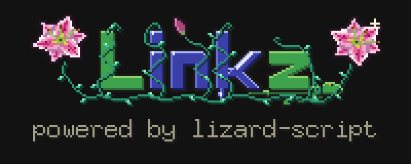
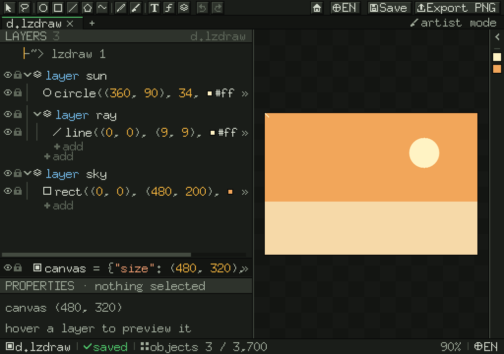
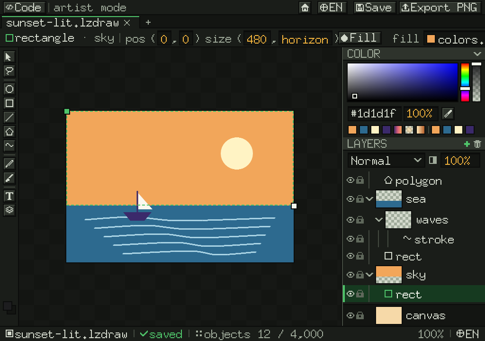
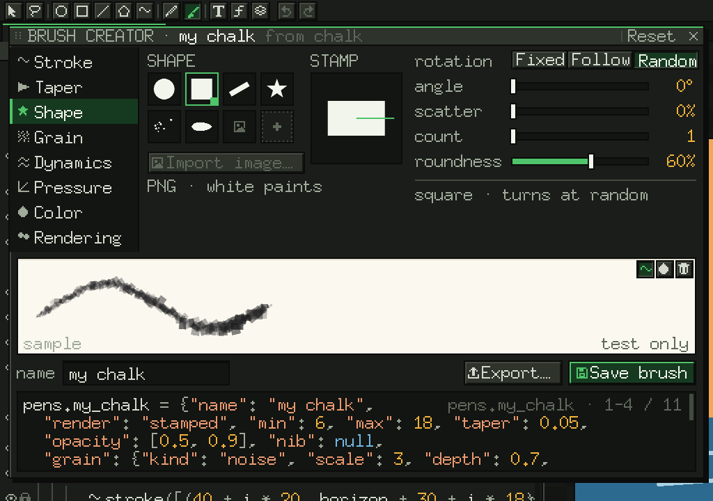
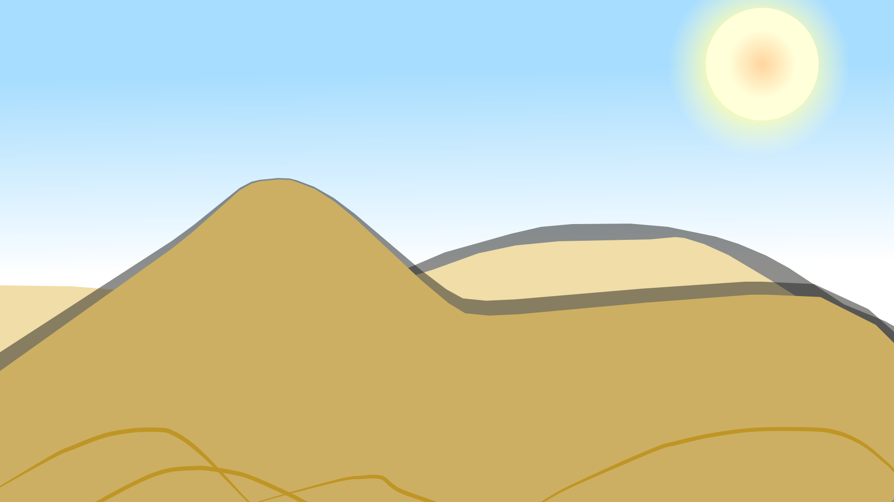

<p align="center">
  
</p>

<h1 align="center">Linkz 🦎</h1>

<p align="center"><i>lizard inkz</i> · a vector art app where <b>the drawing is code</b></p>

<p align="center">
  <a href="https://github.com/alejandruxxug/linkz/releases/latest"></a>
  <a href="LICENSE"></a>
  <a href="https://github.com/alejandruxxug/lizard-script"></a>
  
</p>

<p align="center">
  <a href="#install">Install</a> ·
  <a href="#what-it-does">Features</a> ·
  <a href="#gallery">Gallery</a> ·
  <a href="#try-it">Run from source</a> ·
  <a href="docs/Linkz.md">Docs</a>
</p>



Every shape you draw, drag or recolor is a line of [lizard-script](https://github.com/alejandruxxug/lizard-script), and every line of code is a shape you can grab. Linkz itself is written entirely in lizard-script too: the editor, the rasterizer, the SVG writer, the image tracer and the app around them, run by `lizardscript`.

<table>
  <tr>
    <td width="50%"><br><sub><b>Coder mode</b>: the code <i>is</i> the layers panel</sub></td>
    <td width="50%"><br><sub><b>Artist mode</b>: layers, blend modes, colors</sub></td>
  </tr>
  <tr>
    <td colspan="2"><br><sub><b>Brush creator</b>: every slider writes the brush's code</sub></td>
  </tr>
</table>

A whole drawing is a short program:

```
-~> lzdraw 1
-~> A row of growing circles on a line.

canvas = {"size": (400, 200), "background": #f4f1e8}

for (let i = 0; i < 6; i = i + 1) {
  let c = circle((40 + i * 64, 100), 6 + i * 4, #3fa34d)
  if (i % 2 == 1) {
    c.fill = #e0a526
  }
}
line((20, 100), (380, 100), #1d1d1f, 2)
```

## What it does

- **Two-way editing:** draw with the pencil or the brush, move anchors, recolor, and the code updates; edit the code and the canvas follows. One undo step per gesture.
- **Coder and artist modes**, layers with blend modes and opacity, gradients (linear, radial, stepped), a color wheel with harmonies, select, move and lasso.
- **Brushes:** pressure-sensitive pens, stamped brushes (spray, chalk, leaf, image tips; paper, canvas and hatch grain), a brush creator, `.lzbrush` files you can share.
- **Trace:** turn a picture into editable code. Line art becomes strokes with real widths, flat colors become fills under them, smooth shading becomes gradients; quality presets, an Auto mode, and boxes to ask for more detail where it matters.
- **Zoom** to 3200% without freezing, **export** PNG at any size and SVG.
- **Agents can draw:** `linkz mcp` speaks the Model Context Protocol, so an AI agent draws by writing lizard-script.
- English and Spanish.

## Gallery

Drawn in Linkz. Each picture is the SVG Linkz wrote, and the link under it is the drawing's code.

<table>
  <tr>
    <td width="50%"><br><sub><b>Dune</b> · <a href="docs/Gallery/dune.lzdraw">dune.lzdraw</a></sub></td>
    <td width="50%"><br><sub><b>Purple hair</b> · <a href="docs/Gallery/purple-hair.lzdraw">purple-hair.lzdraw</a></sub></td>
  </tr>
</table>

More to play with in [examples/](examples/).

## Install

Download the archive for your system from the [latest release](https://github.com/alejandruxxug/linkz/releases/latest), or use the install script (it checks the sha256):

```bash
# macOS / Linux: installs to ~/.local/bin (add --system for /usr/local/bin); on macOS, Linkz.app goes to ~/Applications
scripts/install.sh
```

```powershell
# Windows
.\scripts\install.ps1
```

To install an archive you already downloaded: `scripts/install.sh --from-file linkz_<version>_<os>_<arch>.tar.gz --checksums checksums.txt`. Builds: macOS (Apple Silicon and Intel), Windows (amd64), Linux (amd64).

**macOS:** the app is not notarized yet, so the first time, right-click `Linkz.app` → **Open** → **Open**. **Windows and Linux** builds are new and less tested than the Mac one; reports are welcome.

## Try it

Linkz runs on `lizardscript` (build it from [lizard-script](https://github.com/alejandruxxug/lizard-script) with `go build -o lizardscript .`).

```bash
lizardscript run . render examples/hello.lzdraw   # writes examples/hello.svg
lizardscript run . edit                           # the editor
lizardscript build --vm . -o linkz                # one executable: ./linkz edit
```

The plan, the architecture and the design log are in [docs/](docs/Linkz.md).

## Contributing

Linkz is open source, and anyone is welcome to tweak it and send changes back. See [CONTRIBUTING.md](CONTRIBUTING.md). Ideas for the language itself go to [lizard-script](https://github.com/alejandruxxug/lizard-script)'s proposals.

## License

[MIT](LICENSE) © 2026 Alejandro Urrego Giraldo and the Linkz contributors.

