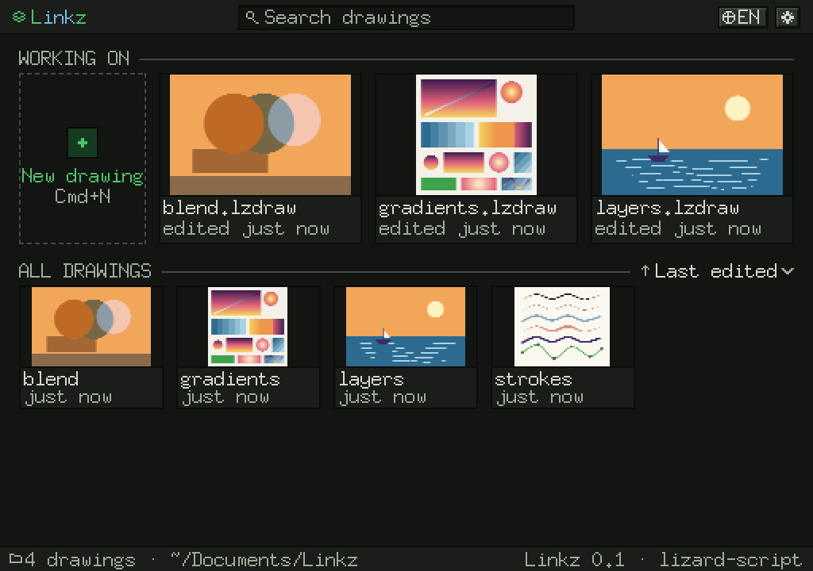
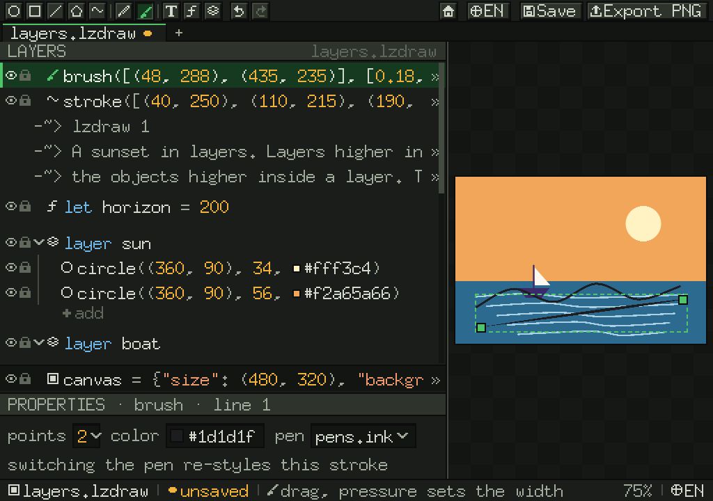

# 🌙 Linkz overnight report — 2026-11-03

Everything below is committed and pushed (30 Linkz commits, 9 lizard-script commits tonight): Linkz to the private repo, language changes to lizard-script `main`. Every commit was checked in a clean checkout (`go test ./...`, cross-build for macOS/Windows/Linux, the smoke run) before pushing, with one exception noted under ⚠️.

## ✅ v1 is done

The finish line you set: **draw a line with the mouse/trackpad and edit it like a vector line.** It works and was tested live through the backdoor.

| What | Status |
|---|---|
| Pencil → a `stroke([...])` row; every native drag sample kept | ✅ |
| Brush with real pressure (trackpad Force Touch / tablet), speed-based with a mouse | ✅ (tablet untested on hardware) |
| 5 pens (ink, pencil, marker, brush, calligraphy) with tunable pressure per brush and per input | ✅ defaults are guesses → **needs your hands** |
| Drag an anchor → only that point's literal changes; double-click adds, Delete removes | ✅ |
| Drag a shape → its literal moves; expression positions are refused with the reason | ✅ |
| Undo/redo for every edit and gesture, ↶ ↷ buttons, caret restore, 200 steps | ✅ |
| Autocomplete (mandatory): ranking, members after `.`, your own names, snippets, signature hints | ✅ |
| Editor drawn by lizard from the approved Linkz Dark frames; code = layers + properties | ✅ |
| Splash: L·INK·z, lizard walking under "ink", vines = progress, Stargazer lilies bloom, `skip_loading_anim` | ✅ |
| Home screen: working / all drawings, lizard-drawn thumbnails, search, rename/duplicate/delete-to-Trash | ✅ |
| English + Spanish everywhere (UI, tooltips) | ✅ |

## 🧱 Also built tonight

- **Gradients** (`linear`, `radial`, shape-relative `gradient`, `radial_gradient`), **steps** and **hard stops**; **color variables can be gradients** (`colors.dusk`).
- **Layer blend modes** (normal, multiply, screen, overlay, darken, lighten, add) + opacity, in the editor, PNG and SVG.
- **Recommended object count** measured per machine: ~510–550 objects on this Mac (`linkz calibrate`).
- **`linkz mcp`** (M7): agents draw by writing lizard and get a PNG back; a `trace` tool turns images into code too. `claude mcp add linkz -- /path/to/linkz mcp`. Docs: [[Linkz – MCP]].
- **Image tracing** (M8): `linkz trace photo.png out.lzdraw` → editable code with a named palette. Your lily photo traces in ~0.6 s at 160 px; the result is posterized/faceted (honest: good start, not a clean illustration yet). Docs: [[Linkz – Tracing]].
- **Windows/Linux**: compiles and vets; clipboard, Recycle Bin, Explorer, locale, **Windows Ink pen pressure**. Not run on a real machine → [[Linkz – Windows Test]].
- **Release prep** (M9), nothing published: GoReleaser config, a release workflow (tags only), CI (manual-only so it doesn't spend Actions minutes), install scripts with checksum checks.

## 🦎 lizard-script (pushed to `main`, all additive, all in DESIGN.md §7)

escapes · dot access · step limit · floats + `math` + units · colors · points · Python-style `layer` · host hooks · `text`/`list` helpers · `null` · `error()` · step counter API · default parameters · `try/catch` · `continue` · `+=` · `\r`/`\u` escapes · O(1) string indexing · source names on tokens/errors.

Only changed meaning: a bare `continue` statement **inside a loop** (it used to be a no-op variable read).

## 📊 Go vs lizard

~13,600 lines of lizard vs ~6,500 of Go (no tests/tools/generated data) — about **⅔ lizard**. Go is the window, input, pixel spans, files, OS calls and the backdoor; everything you see is lizard.

## 🐞 QA

A test-only agent drove the real app through the backdoor (temp HOME, your files untouched). Every item it found is fixed and was re-verified live, including a real brush bug (the first brush stroke after opening the pen picker landed off the canvas — it affected real use, not just the backdoor). Fixed tonight from QA: CLI hang on endless loops, invalid canvas sizes, CLI error lines, stale canvas, slow repaints with 2,000 shapes (0.5–0.9 s → 40–80 ms; ~1 ms when nothing changed), brush coordinates, follow-on parse errors shown dimmed, status bar overlaps, small windows (toolbar overflow », 640×420 minimum) and big windows (panel grows, canvas zooms up), Spanish Home captions, Home rescans when the window regains focus, Cmd+A in fields, Spanish tooltips in the editor.

## ⚠️ Honest notes

- I pushed one commit (`e7e7a95`) with one failing autocomplete test (a count changed when a library helper was added); fixed 2 minutes later in `9c2013b`. Nothing else was pushed red.
- The editor mitigates a lizard-script parser quirk (one bad token can create a fake second error on a later valid line). The real fix changes your team's `syntax_several_errors.expected`, so it **needs the team's agreement** — logged in [[Linkz – Language Needs]].
- Named arguments don't exist in lizard (`gradient(stops, angle = 90deg)` doesn't work); calls are positional. Proposal for the team: `f(angle: 90deg)` (a syntax error today, so additive).

## ⏳ Waiting on you

1. **Approve R002** in Figma (Linkz → 🧪 Reviews → R002, 25 frames; PNGs in `docs/Art/Reviews/R002/`): shape menu + fill editor, palette sidebar + color popover, artist mode, blend modes, tutorial, New drawing dialog + object counter, pen settings, autocomplete polish. Designer's open decisions: artist-mode layout, fill-editor placement, sidebar width (rail by default at 1024 px?), the "color content" exception to the 8-bit palette rule, where "Save as new pen" stores pens.
2. **Feel the pressure**: `go run ./tools/pressureprobe`, then the brush in `linkz edit` with your trackpad and tablet. Tell me which pens feel wrong.
3. **Look at the splash and the editor yourself** (`go build -o linkz . && ./linkz edit`): screen capture is blocked here, so nobody has seen the real window, only the app's own screenshots.
4. Team decisions for lizard-script: the parser recovery fix and named arguments.
5. Optional: turn CI on (`.github/workflows/ci.yml`), test on a Windows PC.

## 🔜 Next

v1.1 batches B016–B021 (menu/fill UI, palette sidebar + popover, artist mode, tutorial, blend UI, object counter UI) as soon as R002 is approved; then the bytecode VM (M6) for speed.
