# 🔍 2026-11-03 – Linkz v1.1 design check (R002 + R003)

The developer approved every R002 and R003 frame on 2026-11-03 ("everything on figma is approved, move it and check it"). This check puts the real v1.1 app in the state of each approved frame and compares the two. No code was changed. The orchestrator turns the 🔴 and 🟡 items into a fix batch.

**How the app shots were taken.** `~/.local/bin/lizardscript run --vm . edit --no-splash` with `LIZARD_AUTOMATION=1` and an isolated `HOME` in a scratch folder (so `~/.linkz` and `~/Documents/Linkz` were never touched), driven with `lizardscript drive --pid N`. The window is 1024×720 (512×360 UI px, ×2). The drawing is the sunset: `examples/layers.lzdraw`, or the same sunset with the frames' `colors` variables, a `shadows` layer or a radial glow. Those drawings are in `docs/Art/Checks/v1.1/drawings/`. The machine's measured budget in the isolated HOME was 4,000 objects (the frames say 1,800; that number is per machine). Home and dialog shots come back from `Screenshot` at 512×360 and are scaled ×2 nearest-neighbor.

**Limits of the backdoor.** `Drag` sends its whole gesture inside one command and only in a straight line. So the states *during* a gesture (the move ghost and `move -30, +40` tooltip, the lasso's marching ants, the stabilizer string and its radius circle, the live pressure readout) can't be captured, and a lasso loop can't be drawn. Those parts are marked "not verifiable". I propose `Press x y`, `Move x y [pressure]`, `Release` and `Path x1 y1 x2 y2 … [--pressure …]` drive commands for the next round. Two more drive quirks: a `Click` with no `Move` before it hits whatever was hovered last (use `Call Hover x y` first), and `Call Tool brush` selects the brush without arming it (a drag drew nothing until the tool button was clicked).

Legend: ✅ matches · 🟡 small differences · 🔴 wrong. Items are ranked inside each frame, most important first. Coordinates are UI px (half of the screenshot px).

## Summary

| Verdict | Count | Frames |
|---|---|---|
| ✅ | 3 | R002-18b-2, R002-18c, R003-2 (what is verifiable) |
| 🟡 | 23 | R002-1, 2, 3, 4, 5, 7, 8, 10, 11, 12, 13, 14, 15, 16, 17, 18b, 19b, 21, 23, 24 · R003-1, 4, 5 |
| 🔴 | 5 | R002-6, R002-9, R002-20, R002-22, R002-25 |
| not verifiable | 1 | R003-3 (needs a lasso loop) |
| not built | 1 | R003-6 trace dialog (waits on the tracing engine) |
| superseded | 2 | R002-18, R002-19 (old pen panel, replaced by the 18b / 19b pop-up) |

### Top issues (cross-cutting, ranked)

1. 🔴 **Named colors are plain text fields.** A fill that is a variable (`colors.sun`, `colors.sky`) is a field of kind `expr` in the properties panel and the artist context bar. It shows no swatch, and clicking it opens a text edit, never the color popover. Expected (R002-4, 24, 25, Style Guide "named colors get a swatch like a literal"): a color field with the variable's swatch, and the popover with that variable marked current. Seen in R002-2, 4, 5, 25.
   ✓ B053 lane A: a field that names a color variable (`colors.sun`) is a color field with the variable's swatch, in the properties and the artist context bar; its swatch opens the popover with the variable current. Shots: [R002-25](../Art/Checks/v1.1/R002-25-named-color-field-es-fixed.png), [R002-5](../Art/Checks/v1.1/R002-05-artist-mode-fixed.png).
2. 🔴 **Autocomplete popup doesn't follow the approved layout** (R002-20, 22). The kind column is missing (a signature or nothing instead), the footer `Tab insert · Esc close` is missing, the doc block has one line instead of signature + doc, matched letters are `amber` instead of `lizard`, the icons are wrong, and there is an extra `SUGGESTIONS · N` header. Typing an unfinished name also throws the whole drawing into the error state while you type.
   ✓ B053 lane B: the popup is the approved one (214 wide, 14 px rows, kind column, icons, signature + doc block, footer, `lizard` letters, no header), and the errors of the row being typed wait until the caret leaves it. Shots: [R002-20](../Art/Checks/v1.1/R002-20-autocomplete-fixed.png), [ES](../Art/Checks/v1.1/R002-20-autocomplete-es-fixed.png), [R002-21](../Art/Checks/v1.1/R002-21-signature-hint-fixed.png), [R002-22](../Art/Checks/v1.1/R002-22-member-completion-fixed.png).
3. 🔴 **Menus leave the window.** The Fill ▸ submenu flips left and is clipped at x < 0 (R002-9). The shape menu runs down over the status bar to y 356 (R002-1, 9). Spec: menus flip left/up at the window edge and stay inside the window, above the status bar.
   ✓ B053 lane A: the shape menu, its submenus and the blend dropdown end above the status bar; a submenu with no room on either side takes the roomier one and is kept inside x ≥ 1. Shots: [R002-1](../Art/Checks/v1.1/R002-01-shape-menu-fixed.png), [R002-9](../Art/Checks/v1.1/R002-09-spanish-menu-fill-fixed.png).
4. 🔴 **Artist selection isn't revealed** (R002-6). Selecting the sun on the canvas leaves its folded layer closed in LAYERS (no row highlighted) and doesn't scroll or highlight the code drawer. The drawer also opens 37 px too low (y 233, spec 196), and the canvas doesn't drop to 75%.
   ✓ B053 lane C: a shape picked on the canvas unfolds its layers, gets the `moss` row in LAYERS and scrolls the drawer to its selected row; the drawer opens at y 196 (148 high, the column's tools pack above it) and the canvas drops to 75%; the compact palette and the fill chip follow the selection. Shots: [R002-6](../Art/Checks/v1.1/R002-06-artist-code-drawer-fixed.png), [R002-5](../Art/Checks/v1.1/R002-05-artist-mode-fixed-layout.png).
5. 🟡 **Status bar object counter.** It truncates to `objects 3,400 / 4…` whenever the cursor position is shown, even with ~100 px free. While brush or pencil is active, the tool hint *replaces* the counter. After a language change the tool hint stays in the old language (R002-13, 14, 17).
   ✓ B053 lane C: the counter always follows the file's state and never shortens (a note after it, then the cursor position, then the file name give way); the tool hint moved into the properties and is read in the language now. Shots: [R002-17](../Art/Checks/v1.1/R002-17-object-counter-fixed.png), [EN](../Art/Checks/v1.1/extra-status-counter-truncated-fixed.png), [ES](../Art/Checks/v1.1/extra-status-hint-stale-es-fixed.png).
6. 🟡 **Canvas zoom ignores the R002 rule.** Coder with rail 75% (spec 90%), sidebar open 50% (55%), artist 100% (125%), artist + drawer 100% (75%).
   ✓ B053 lane C: the zoom is the largest step (now with 125, 90, 75 and 55%) that leaves 10 UI px around the drawing: 90% rail, 55% open palette, 125% artist, 75% artist + drawer. Shots: [90%](../Art/Checks/v1.1/extra-status-counter-truncated-fixed.png), [55%](../Art/Checks/v1.1/R002-10-tutorial-1-fixed.png), [125%](../Art/Checks/v1.1/R002-05-artist-mode-fixed-layout.png), [75%](../Art/Checks/v1.1/R002-06-artist-code-drawer-fixed.png).
7. 🟡 **Bars overflow and hints clip mid-word.** The artist context bar runs off the right edge (`●Fil`, `stabilizer O…`, `…la ajusta  estabi`). Property hints are cut mid-word (`pick a pen · the gear t`). The coder brush properties wrap the stabilizer length into an orphan `24 px` with no slider (R002-5, 13, 14, R003-4).
   ✓ B053 lane C: the context bar drops the layer name, then the Fill button's word, then pages what is left behind a » button; with the brush or pencil the bar and the properties are the tool's inspector (`brush · layer | pen ▾ ⚙ | stabilizer … 24 px`), in two rows in coder mode (the canvas row stays at y 263); hints end at a word with `…`. Shots: [R003-4](../Art/Checks/v1.1/R003-04-brush-stabilizer-fixed.png), [ES](../Art/Checks/v1.1/extra-artist-context-bar-overflow-fixed.png), [R002-13](../Art/Checks/v1.1/R002-13-tutorial-4-fixed.png).
8. 🟡 **Floating panels cover what they edit.** The fill editor sits over the canvas and the shape (R002-9). The color popover covers the literal it edits (R002-23, R003-5) or the tab bar (R002-25), and it jumps sideways when "Save as variable…" opens (R002-24).
   ✓ B053 lane A: the fill editor goes over the code when the canvas is narrow; the popover opens under (or over) what was clicked, else beside it without covering the literal, and keeps its size when "Save as variable…" opens (the name field takes that row's place, as in the frame). Shots: [R002-9](../Art/Checks/v1.1/R002-09-spanish-fill-editor-fixed.png), [R002-23](../Art/Checks/v1.1/R002-23-color-popover-row-fixed.png), [R002-24](../Art/Checks/v1.1/R002-24-color-popover-field-fixed.png), [R002-25](../Art/Checks/v1.1/R002-25-color-popover-artist-es-fixed.png), [R003-5](../Art/Checks/v1.1/R003-05-color-wheel-harmonies-fixed.png).
9. 🟡 **Overlays that stay or stack.** The signature hint stays up while the color popover is open and while using the select tool (R002-23, R003-1). The select tool's 8 handles + rotation stalk draw on top of the gradient handles (R002-2, 3, 9). A selected layer gets no dashed box on the canvas (R002-7, 8). Two amber focus rings show at once (R002-8).
   ✓ B053 lane A: the signature hint waits while the popover is open and after a canvas tool or a swatch moved the caret (it comes back when the caret moves); the select handles and a shape's anchors give way to the gradient handles while the fill editor is open; a selected layer gets the dashed box; the blend dropdown rings only the control that opened it. Shots: [R003-1](../Art/Checks/v1.1/R003-01-select-move-fixed.png), [R002-2](../Art/Checks/v1.1/R002-02-fill-linear-select-fixed.png), [R002-7](../Art/Checks/v1.1/R002-07-blend-coder-fixed.png), [R002-8](../Art/Checks/v1.1/R002-08-blend-artist-fixed.png).
10. 🟡 **Spanish gaps.** Built-in pen names (`ink`, `mi ink`, frame `tinta`), `Untitled 3` in the dialog, the brush status hint, the pencil/calligraphy descriptions in the picker, and runtime error messages stay English.
   ✓ B053 lane C: built-in pens show `tinta`, `lápiz`, `marcador`, `pincel`, `caligrafía` (picker, window title, `mi tinta`), the dialog proposes `Sin título N` and follows a language change, the picker's descriptions fit (shorter Spanish words, cut at a word), the tool hint is in the language, and the error row translates the language's message kinds and common phrases (`error de ejecución: número de argumentos incorrecto`). Shots: [R002-19b](../Art/Checks/v1.1/R002-19b-pen-settings-popup-artist-es-fixed.png), [picker](../Art/Checks/v1.1/extra-pen-picker-es-fixed.png), [R002-16](../Art/Checks/v1.1/R002-16-new-drawing-es-fixed.png), [error](../Art/Checks/v1.1/R002-09-spanish-runtime-error-fixed.png).

---

## R002-1 Shape menu – right-click on canvas, Fill ▸ open · 🟡

| Approved (`21:3121`) | App |
|---|---|
| 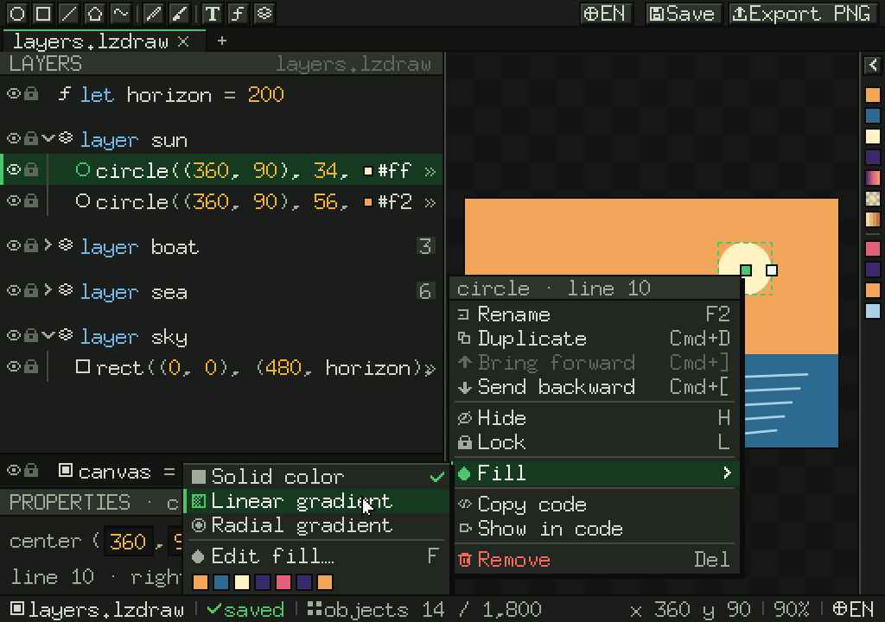 | 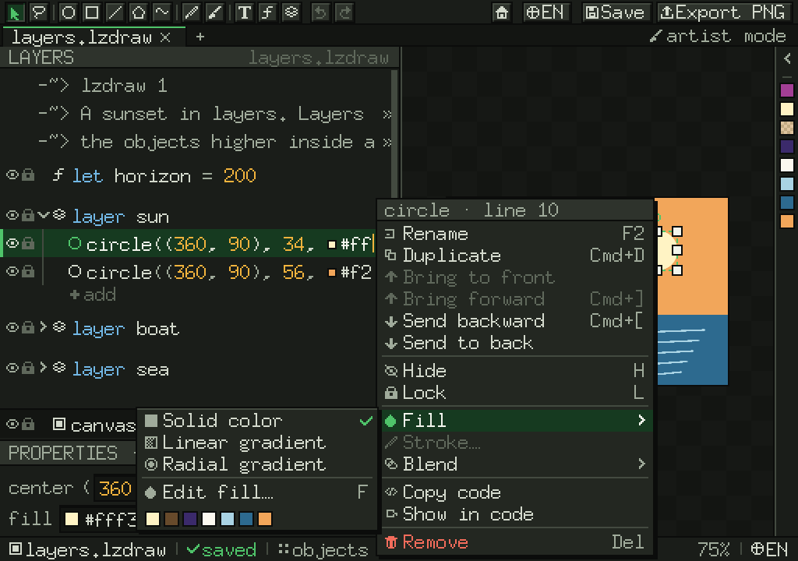 |

Matches: header `circle · line 10`, items, shortcuts, disabled Bring forward, separators, Fill ▸ hover (`moss`, `lizard` icon, `bright` text), submenu with Solid ✓ / Linear / Radial / Edit fill… F and the swatch row with gradient chips, `ember` Remove.

1. **Menu runs over the status bar.** Menu bottom at y 356, status bar starts at 344. Expected: when the menu doesn't fit below the click, it flips or shifts up so its bottom stays ≤ 343. Partly caused by item 2.
   ✓ The menu shifts up so its box ends at y 341, above the status bar ([shot](../Art/Checks/v1.1/R002-01-shape-menu-fixed.png)). Item 2's extra items are kept (the review proposes drawing them in).
2. **Four extra items** (Bring to front, Send to back, Stroke…, Blend ▸) make the menu 56 UI px taller than the approved one. They are useful; keep them but let the menu fit (item 1). Either add them to the frame in a design pass, or group Bring to front / Send to back under an `Arrange ▸` submenu.
3. Canvas zoom 75% with the rail (spec 90%); see top issue 6.
   ✓ 90% with the rail (top issue 6, [shot](../Art/Checks/v1.1/extra-status-counter-truncated-fixed.png)).

## R002-2 Fill editor – linear gradient on the sky · 🟡

| Approved (`21:3151`) | App |
|---|---|
| 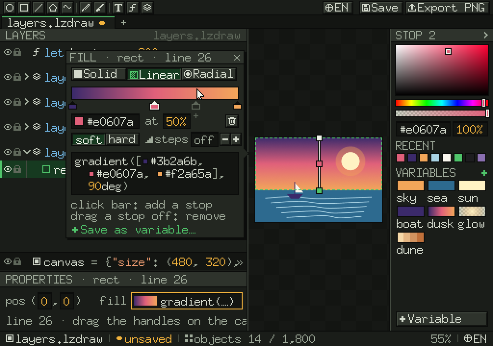 | 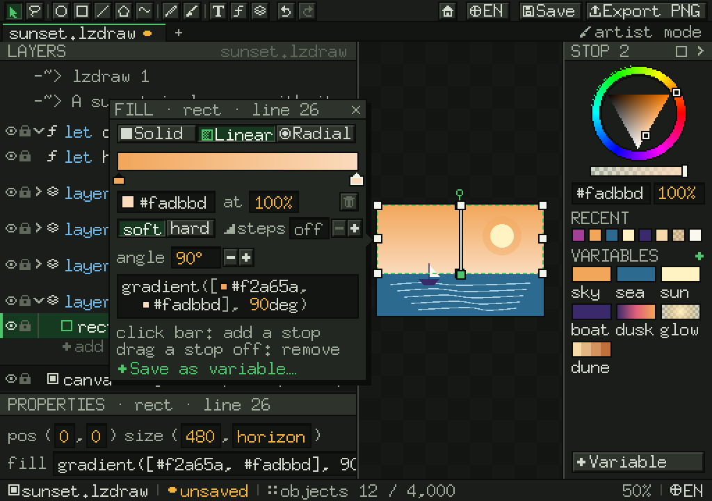 |

Matches: floating 186-wide editor with 5-step tail, kind tabs, gradient bar with stop markers (pixel-identical style), stop row (color, `at`, trash), soft/hard + steps, code preview, the two hints, `+ Save as variable…`, sidebar header `STOP 2`, linear handles on the canvas.

1. **The select tool's box draws over the gradient handles.** The 8 `bright` handles and the rotation stalk sit on top of the linear start/end handles. Expected: while the fill editor is open, only the dashed box and the gradient handles.
   ✓ While the fill editor is open only the dashed box and the gradient handles show, with any tool ([Select](../Art/Checks/v1.1/R002-02-fill-linear-select-fixed.png), [shot](../Art/Checks/v1.1/R002-02-fill-linear-fixed.png)).
2. **Properties fill field shows raw text** `gradient([#f2a65a, #fadbbd], 90`, clipped. Expected: the gradient chip + `gradient(…)` in an `amber` focused field while the editor is open.
3. Extra row `angle 90° − +` (not in the frame). Fine as an addition. It makes the editor 22 px taller, so check it still fits beside a shape near the bottom.
4. Before Linear was chosen, the properties fill showed `colors.sky` with no swatch (top issue 1).
   ✓ `fill [■ colors.sky]` now has the swatch, and it opens the popover (top issue 1).

## R002-3 Fill editor – stepped gradient, 5 bands · 🟡

| Approved (`21:3181`) | App |
|---|---|
|  | 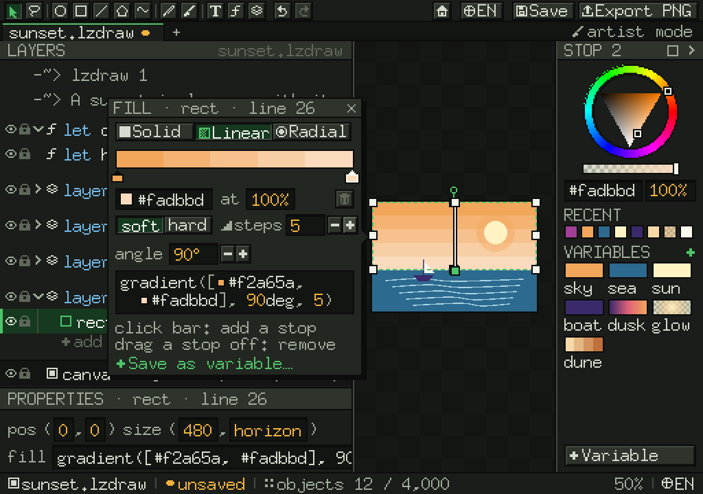 |

Five flat bands on the bar and the canvas, `steps 5`, code `…, 90deg, 5)` ✅.

1. **Properties don't show the steps.** Expected `steps [5]` field and hint `line 26 · 5 flat bands, no blending`. The app shows the clipped `fill gradient(…` text.
2. Same handle overlap as R002-2.
   ✓ As R002-2 ([shot](../Art/Checks/v1.1/R002-03-fill-stepped-fixed.png)).

## R002-4 Palette sidebar – editing variable `colors.sky` · 🟡

| Approved (`21:3214`) | App |
|---|---|
| 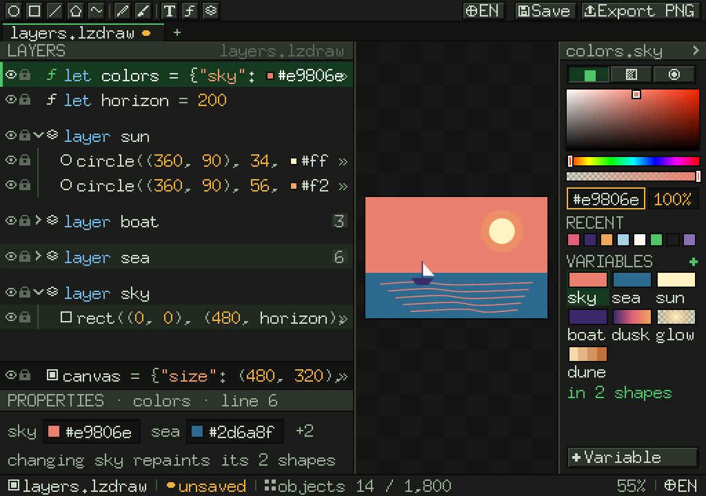 | 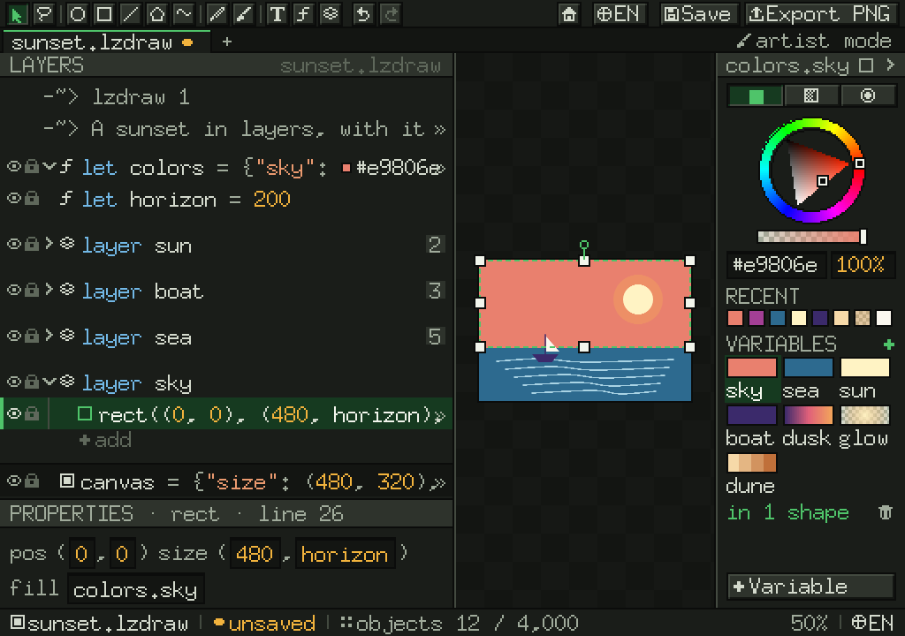 |

Double-clicking the `sky` chip edits the variable: header `colors.sky`, kind tabs, `moss` cell, `in 1 shape` + trash, and the new hex repaints the sky live ✅. The picker is the ring + triangle (approved: ring by default), with the ring/square toggle in the header ✅.

1. **The variable's row isn't selected.** Expected: row 6 `let colors` selected (`moss` + bar) and properties `colors · line 6` with `sky [■ #e9806e] sea [■ #2d6a8f] +2` and hint `changing sky repaints its 2 shapes`. The app keeps the rect selected and its properties.
2. Zoom 50% with the sidebar open (spec 55%).
   ✓ 55% with the sidebar open ([shot](../Art/Checks/v1.1/R002-10-tutorial-1-fixed.png)).

## R002-5 Artist mode – sunset · 🟡

| Approved (`21:3240`) | App |
|---|---|
| 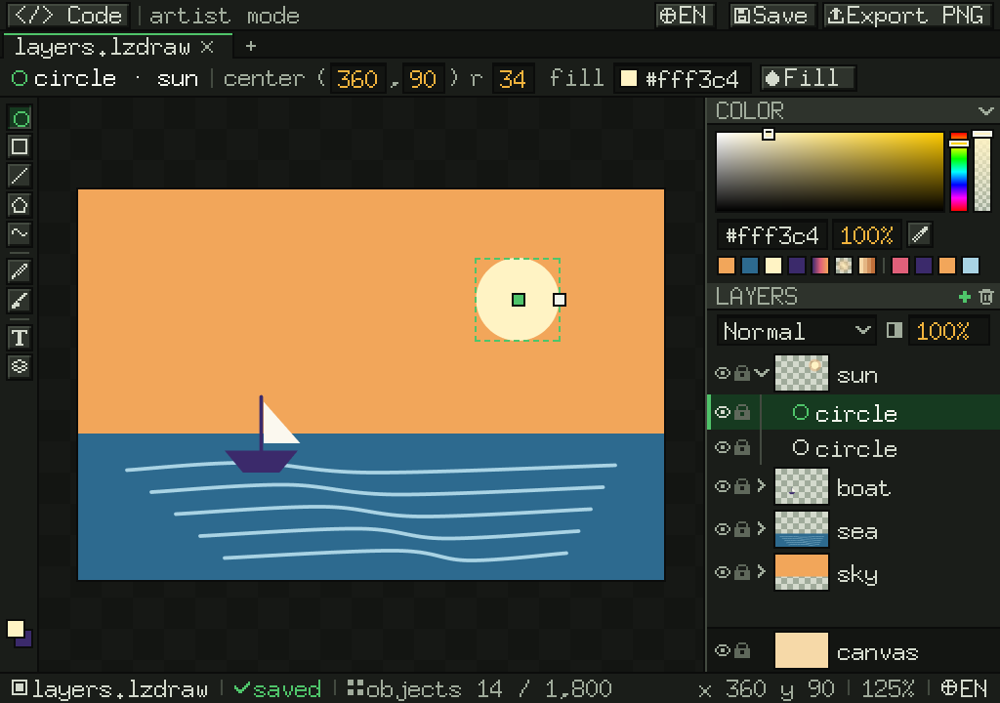 | 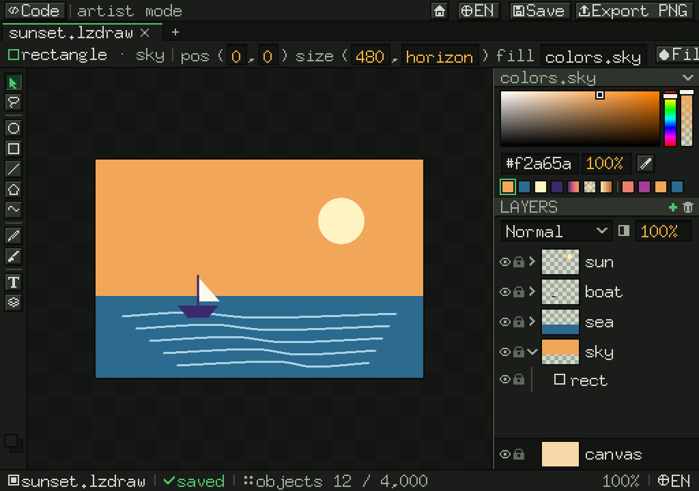 |

Matches: toolbar with the `Code` toggle + `artist mode`, context bar, tool column (select and lasso first), compact palette, `LAYERS` header with + and trash, blend dropdown + opacity, 22-high layer rows with thumbnails, `canvas` row pinned.

1. **Context bar overflows.** With fill `colors.sky` the Fill button is cut to `●Fil` at the right edge. Expected: fields shrink or the bar drops lower-priority parts, never clipping a button (see R003-4 too).
   ✓ Nothing clips: the layer name leaves the title, the Fill button keeps its icon (it now sits right after the fill field), and what still doesn't fit waits behind » ([shot](../Art/Checks/v1.1/R002-05-artist-mode-fixed-layout.png)).
2. **Fill/stroke chips at the foot of the tool column show `#1d1d1f` and empty**, not the selection's fill (`colors.sky` → `#f2a65a`) and stroke. Expected: the chips show the selected shape's fill and stroke, else the current colors.
   ✓ The fill chip shows (and its popover edits) the selected shape's fill, the stroke chip its stroke; with nothing selected, or while the brush paints, the current color ([shot](../Art/Checks/v1.1/R002-05-artist-mode-fixed-layout.png)).
3. Zoom 100% (spec 125%: canvas area 20–360 fits 62.5% UI).
   ✓ 125% ([shot](../Art/Checks/v1.1/R002-05-artist-mode-fixed-layout.png)).
4. `Code` toggle shows an icon + `Code`; the frame has `</> Code`. Fine if the icon reads as `</>`.

## R002-6 Artist mode – code drawer open · 🔴

| Approved (`21:3285`) | App |
|---|---|
| 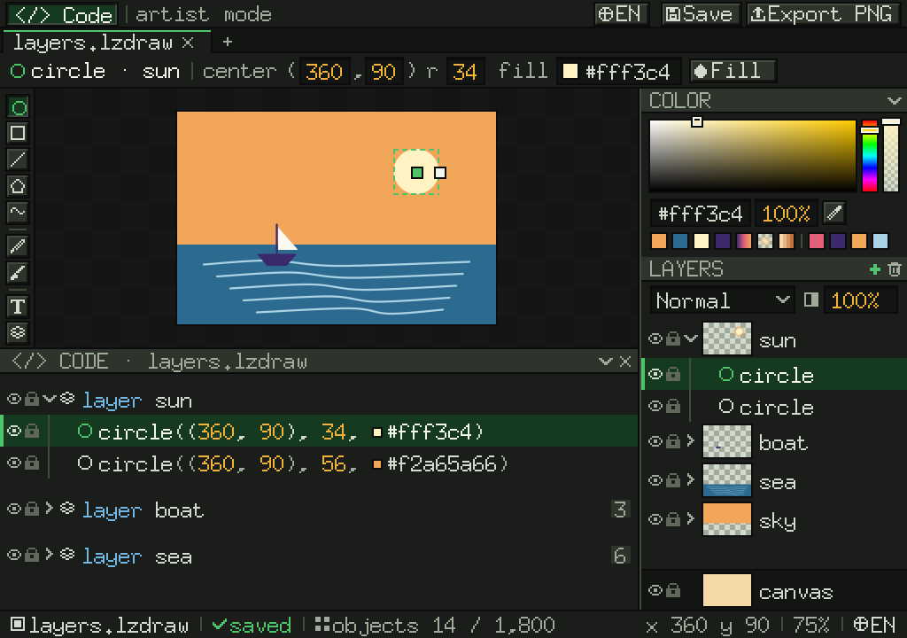 | 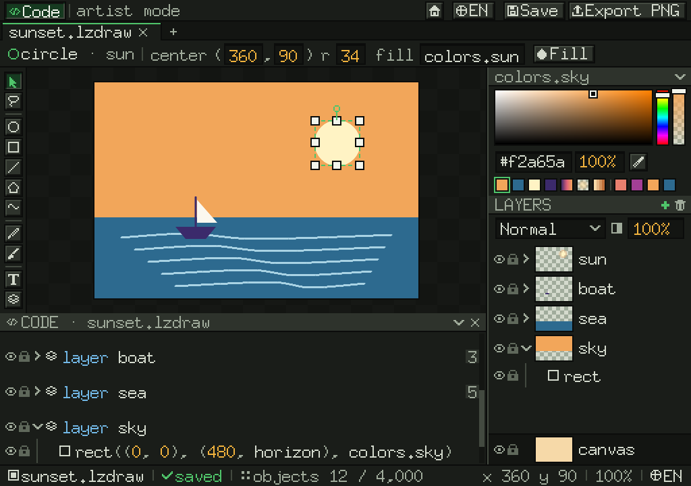 |

1. **Selecting on the canvas doesn't reveal the object.** After clicking the sun, the folded `sun` layer stays closed in LAYERS (no row highlighted), and the drawer keeps showing the sky rows. Expected: the layer opens and `circle` gets `moss` + 2 px bar in LAYERS, and the drawer scrolls to line 10 and selects it. When the layer is already open, the LAYERS highlight does work (see R002-25).
   ✓ The click unfolds `sun`, its `circle` row gets `moss` + bar in LAYERS, and the drawer scrolls to line 10 and selects it ([shot](../Art/Checks/v1.1/R002-06-artist-code-drawer-fixed.png)).
2. **Drawer opens 37 px too low.** Header at y 233; spec y 196. The drawer is then 111 high instead of 148, so only about 4 rows show.
   ✓ Header at y 196, 148 high. The column keeps all eleven tools above it (groups close up, tools shrink to 11×11 at step 12 only while the drawer is open).
3. **Canvas zoom doesn't drop.** It stays 100%; spec says it drops to 75% when the drawer opens.
   ✓ 75% over the drawer.
4. **Palette is stuck in variable-edit mode.** The compact palette header still says `colors.sky` after another shape is selected. Expected: `COLOR` with the selection's fill (`#fff3c4`).
   ✓ Picking another shape ends the variable edit: the palette shows the selection's fill (`COLOR #fff3c4` for a literal; a fill that names a variable shows and edits that variable, so the header says `colors.sun` on the variables sunset).

## R002-7 Blend modes – coder, `shadows` in Multiply · 🟡

| Approved (`21:3331`) | App |
|---|---|
| 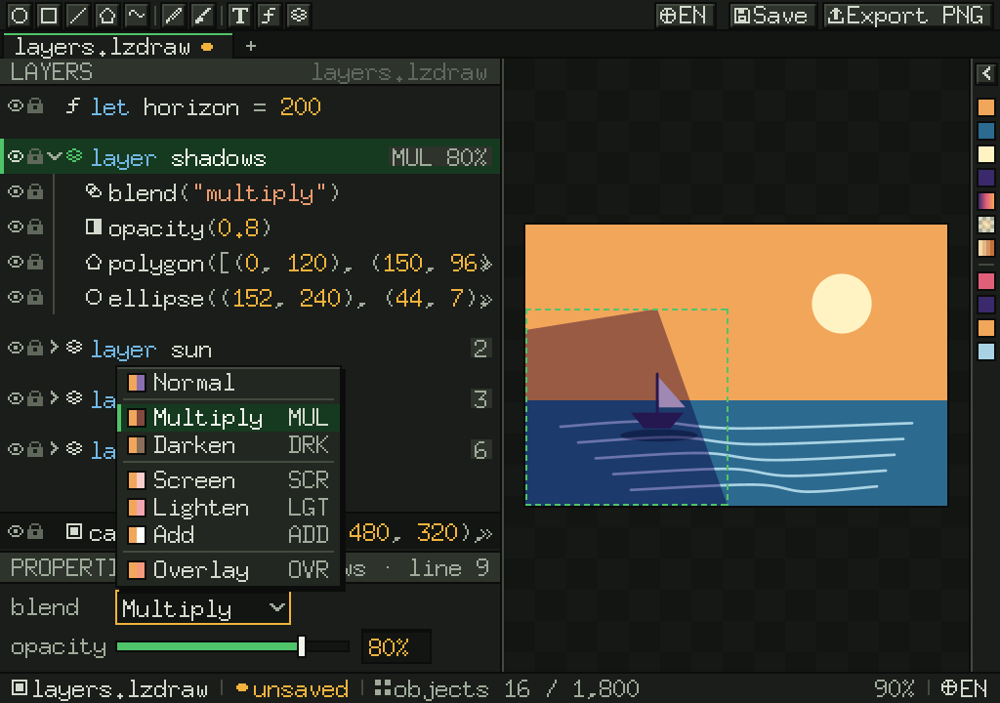 | 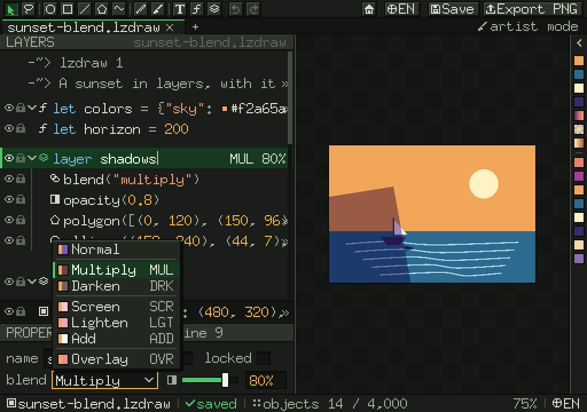 |

Multiply 80% really renders. The `MUL 80%` badge, the `blend("multiply")` / `opacity(0.8)` rows, and the properties dropdown (same list, previews, 3-letter codes, current `moss`) ✅.

1. **No dashed box around the selected layer on the canvas.** Expected: a dashed `lizard` box around the layer's content.
   ✓ A dashed `lizard` box 2 UI px around everything the layer draws ([shot](../Art/Checks/v1.1/R002-07-blend-coder-fixed.png)).
2. Properties add a `name / hidden / locked` row above blend. Fine, but then the opacity slider loses its `opacity` label (only the ◧ icon). Keep the label.
3. Zoom 75% (spec 90%).
   ✓ 90% (top issue 6).

## R002-8 Blend modes – artist, dropdown open · 🟡

| Approved (`21:3362`) | App |
|---|---|
| 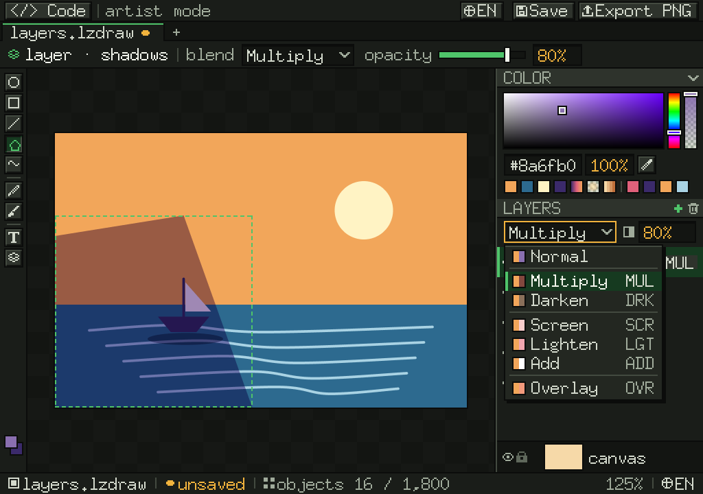 | 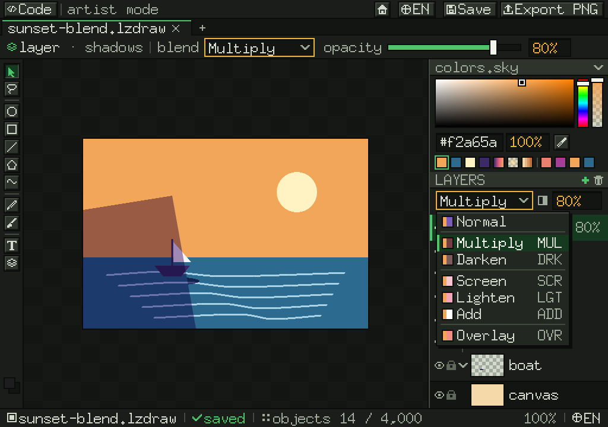 |

Dropdown, list and context bar (blend + opacity slider + `80%`) match ✅.

1. **Layer row truncates the name to `sh…`** to fit `MUL 80%`. Expected: name first. In artist rows the badge is `MUL` (the opacity is already in the header field), or the badge shrinks before the name does.
   ✓ The name comes first: when it and `MUL 80%` don't both fit, the badge drops to `MUL` (the header shows the opacity) ([shot](../Art/Checks/v1.1/R002-08-blend-artist-fixed-layout.png)).
2. **Two amber focus rings at once**: the context-bar dropdown and the header dropdown. Only the open control gets `amber`.
   ✓ The dropdown remembers which control opened it; only that one is `amber` ([shot](../Art/Checks/v1.1/R002-08-blend-artist-fixed.png)).
3. No dashed layer box on the canvas (as R002-7). Zoom 100% (125%). Palette header still `colors.sky` (as R002-6).
   ✓ The dashed layer box shows ([shot](../Art/Checks/v1.1/R002-08-blend-artist-fixed.png)); zoom and palette are lane C's.
   ✓ Lane C part: 125% ([shot](../Art/Checks/v1.1/R002-08-blend-artist-fixed-layout.png)), and the palette follows the selection (as R002-6).

## R002-9 Spanish – shape menu + fill editor (radial, hard stop) · 🔴

| Approved (`21:3414`) | App |
|---|---|
| 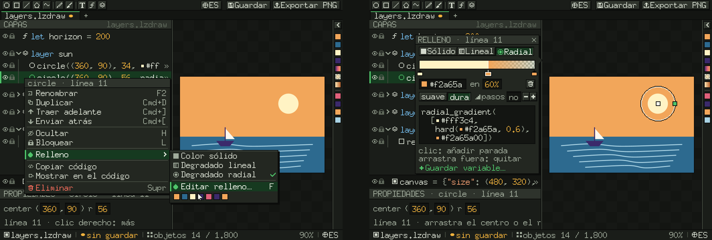 | 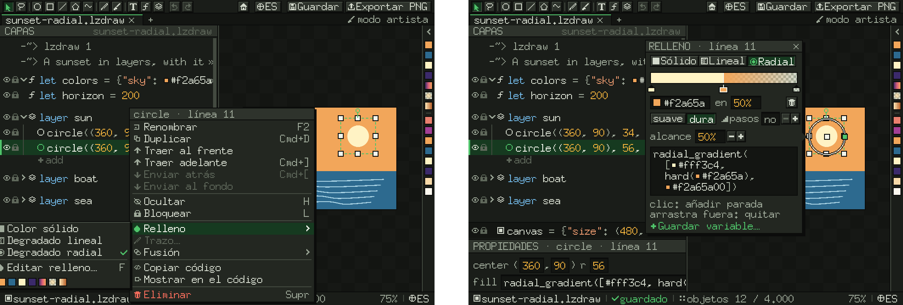 |

Spanish labels are all in (Renombrar … Eliminar, Relleno ▸ Color sólido / Degradado lineal / Degradado radial / Editar relleno…, RELLENO · línea 11, Sólido/Lineal/Radial, en, suave/dura, pasos no, hints, Guardar variable…). The hard stop renders sharp, and the radial handles (centre, ring, radius) show ✅.

1. **Submenu clipped off the window.** `Relleno ▸` opens to the left and its first column (icons) is cut at x 0. Expected: clamp it inside the window, x ≥ 0, or open on the right and shift it left until it fits.
   ✓ Neither side has room for `Relleno ▸` here, so it opens on the roomier (left) side, kept at x 1 ([shot](../Art/Checks/v1.1/R002-09-spanish-menu-fill-fixed.png)).
2. **Fill editor covers the shape.** It sits at x 209–394, across the splitter and over the canvas, and hides the left of the glow and its handles. Expected (spec, frame): over the code panel when the canvas is narrow, with the tail pointing at the shape.
   ✓ When the canvas is too narrow for it left of the shape, it goes over the code panel (x 65–251), tail toward the shape ([shot](../Art/Checks/v1.1/R002-09-spanish-fill-editor-fixed.png)).
3. Menu runs over the status bar (as R002-1).
   ✓ As R002-1.
4. Extra `alcance 50% − +` row (radius). Fine as an addition. The select handles draw over the radial handles (as R002-2).
   ✓ The handle overlap is gone (as R002-2); the `alcance` row is kept.
5. The runtime error message for a wrong `hard(…)` call stays English (`runtime error: wrong number of arguments`). That's R001 scope, but it shows in Spanish.
   ✓ The error row says the language's kinds and common phrases in Spanish (`error de ejecución: número de argumentos incorrecto: se esperan 1, hay 2`; names and values stay as written) ([shot](../Art/Checks/v1.1/R002-09-spanish-runtime-error-fixed.png)).

## R002-10 Tutorial 1 – Make your first shape · 🟡

| Approved (`21:3472`) | App |
|---|---|
| 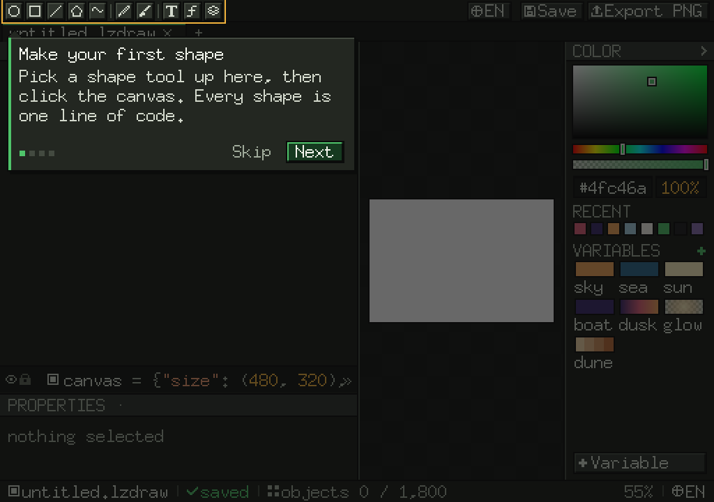 | 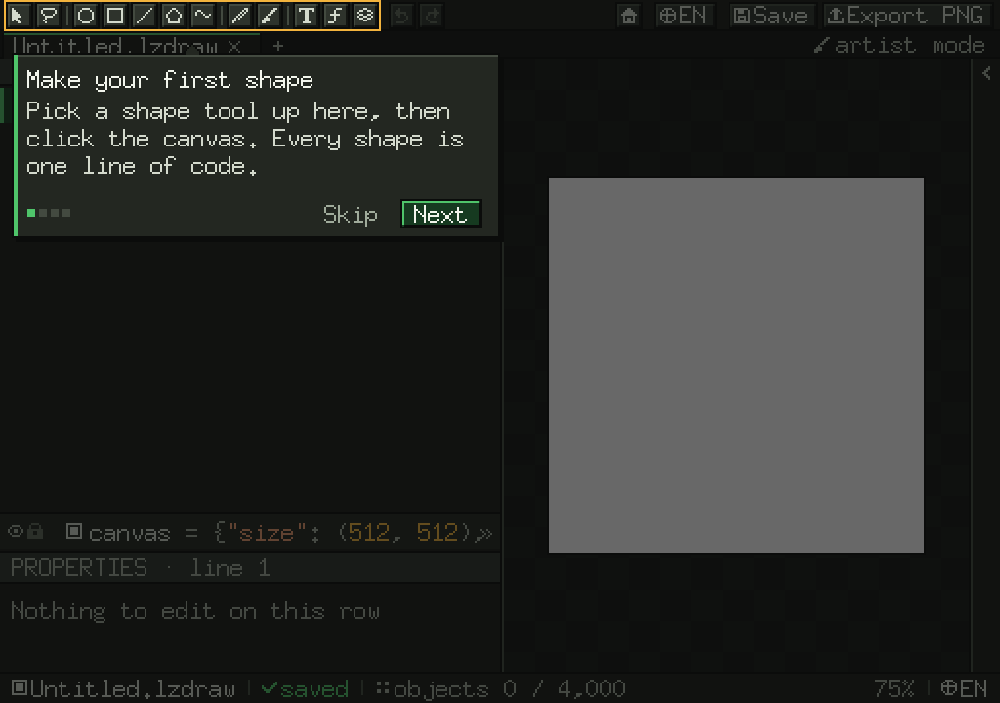 |

The coach-mark (box, 2 px `lizard` bar, title, body, step dots, Skip, Next) and the `amber` ring around the tool strip match. The 62% `void` dim is applied (amber text measures `#634c1e`).

1. **Palette sidebar starts collapsed to the rail** for a new drawing; the frame has it open (COLOR, RECENT, VARIABLES). Step 2 relies on it (see R002-11). Expected: open by default, or the tutorial opens it.
   ✓ The tutorial opens the sidebar when it starts in coder mode ([shot](../Art/Checks/v1.1/R002-10-tutorial-1-fixed.png)).
2. New drawing default is 512×512 white; the frame and dialog had 480×320 (see R002-15).
   ✓ The dialog's first preset and default is 480×320 (R002-15).

## R002-11 Tutorial 2 – Change its color · 🟡

| Approved (`21:3487`) | App |
|---|---|
| 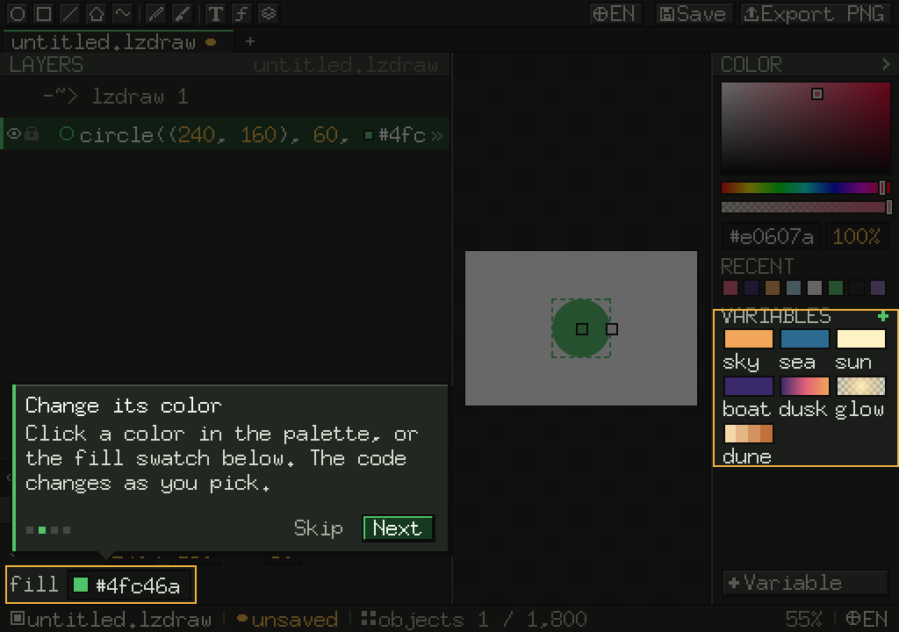 | 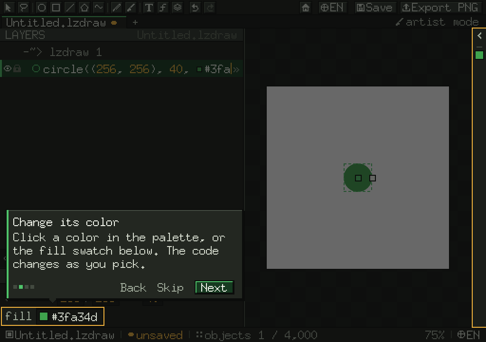 |

1. **The spotlight rings the whole 14 px rail**, not the VARIABLES block plus the fill field. That follows from R002-10 item 1.
   ✓ It rings the VARIABLES block and the fill field (the sidebar is open, R002-10).
2. A `Back` button is added on steps 2–4. Good, keep it. The frame shows it only on step 4.
3. Opening the fill popover from the spotlit field hides the coach-mark and the dim until it closes. Expected: the coach-mark waits (dimmed is fine) and the step completes when a color is picked. It does complete ✅.
   ✓ The coach-mark and the spotlight stay, under the popover (its parts take the clicks); the step completes on the pick ([shot](../Art/Checks/v1.1/R002-11-tutorial-2-fixed.png)). Back is kept (item 2).

## R002-12 Tutorial 3 – First brush stroke · 🟡

| Approved (`21:3504`) | App |
|---|---|
| 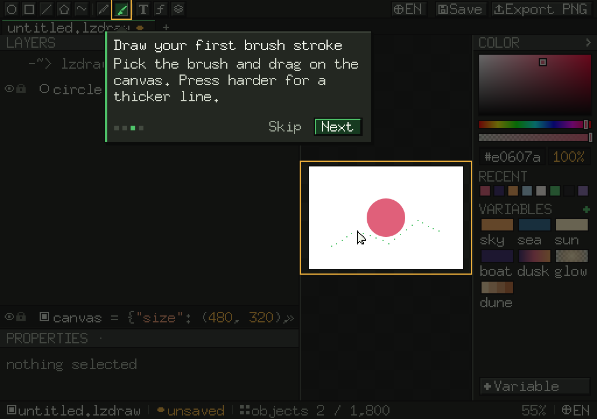 | 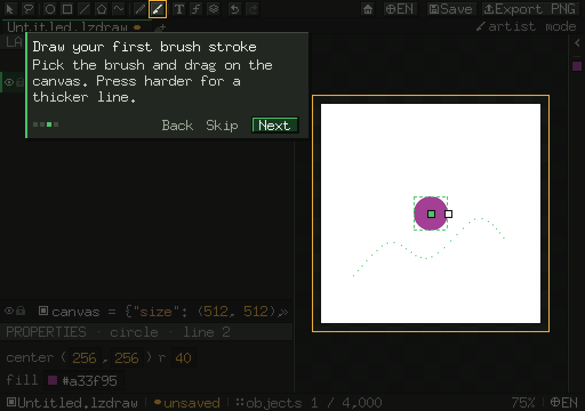 |

Brush button ring, canvas ring and dotted ghost stroke ✅.

1. The circle stays selected, with its handles and its properties (`center`, `r`, `fill`), while the step asks for a brush stroke. Expected: picking the brush deselects (frame: `nothing selected`).
   ✓ While the brush is picked nothing shows selected on the canvas, and the properties are the brush's inspector (as R003-4) instead of the circle's fields ([shot](../Art/Checks/v1.1/R002-12-tutorial-3-fixed.png)).

## R002-13 Tutorial 4 – Peek at the code (done) · 🟡

| Approved (`21:3522`) | App |
|---|---|
| 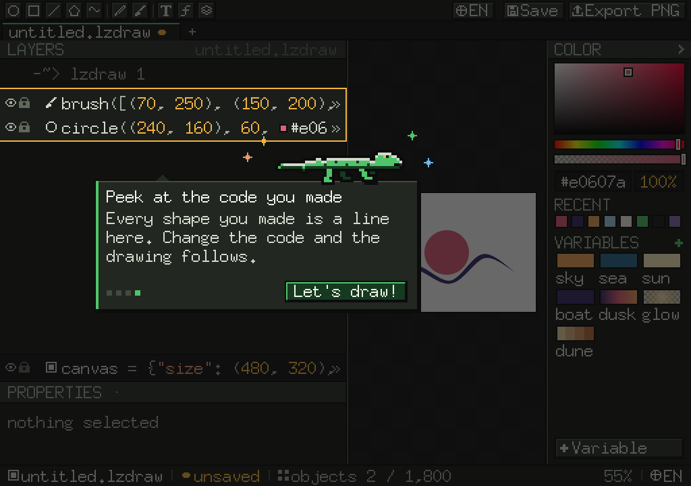 | 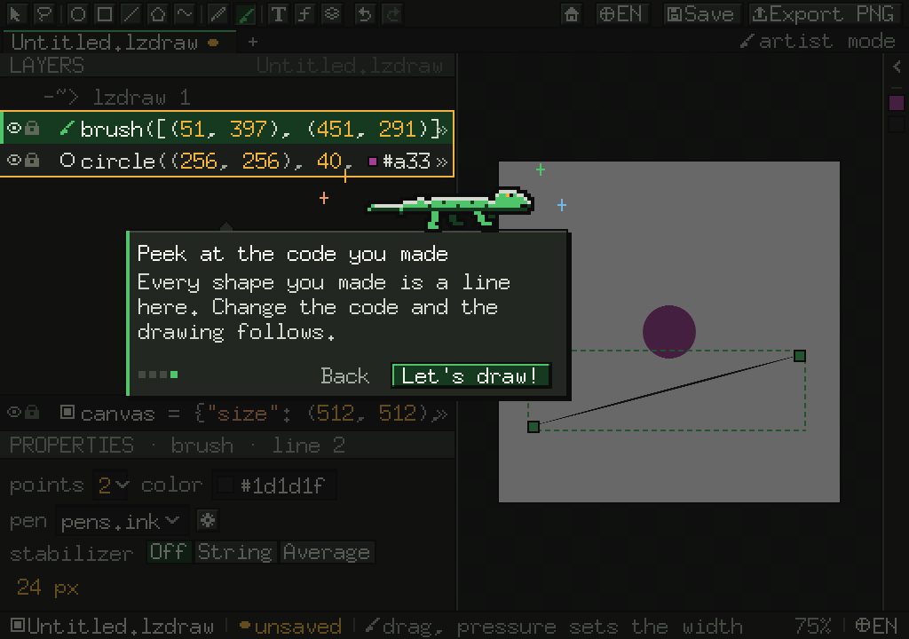 |

The lizard with sparkles, the `amber` ring on the new rows, and `Let's draw!` ✅.

1. **The properties panel grows to 5 rows** (`points`/`color`, `pen` + ⚙, `stabilizer Off/String/Average`, an orphan `24 px`). It pushes the pinned `canvas` row up from y 263 to y 232. Expected: properties stay at y 282–344 (the brush inspector fits in 2 rows: put `24 px` with its slider on the stabilizer row), and the canvas row stays pinned.
   ✓ The brush inspector is two rows (`pen [ink ▾] ⚙ hint`, `stab. Off String Average 24 px`, the label short at 256), so the canvas row stays at y 263 ([shot](../Art/Checks/v1.1/R002-13-tutorial-4-fixed.png)). The length is still dragged as a number (no slider: it doesn't fit 256).
2. **The status bar counter is replaced** by the tool hint `drag, pressure sets the width`. Expected: `objects N / MAX` always right after `saved`; the tool hint goes in the properties hint line (top issue 5).
   ✓ `objects N / MAX` stays after `unsaved`; the hint is in the properties (top issue 5).
3. The stroke was laid as 2 points with almost no width change (drive input, straight line).

## R002-14 Tutorial 1 – Spanish · 🟡

| Approved (`21:3541`) | App |
|---|---|
| 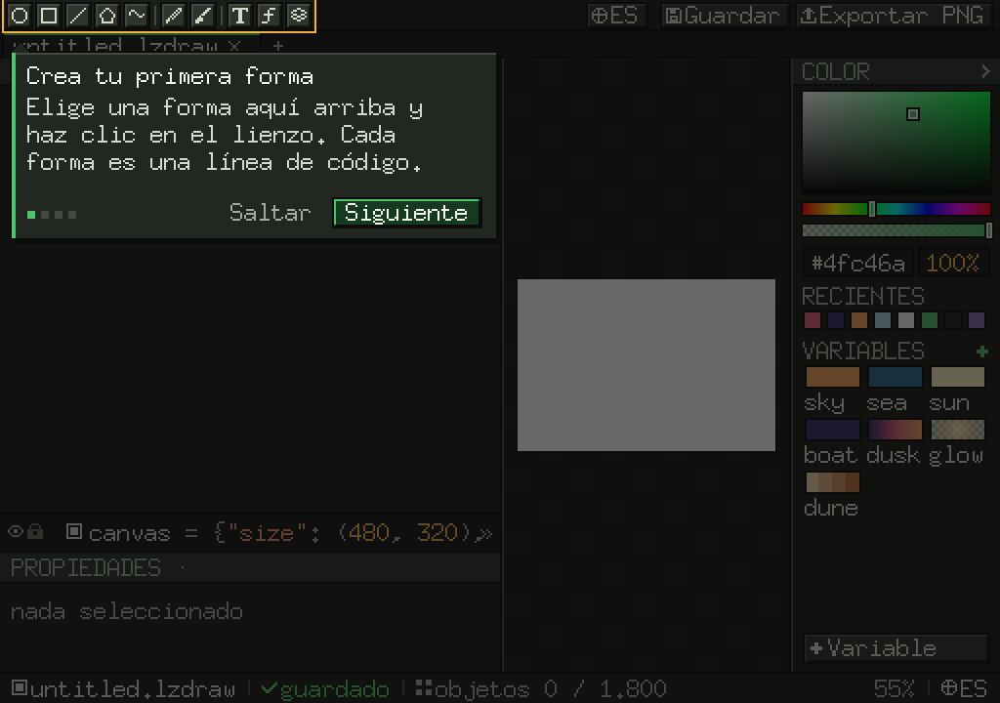 | 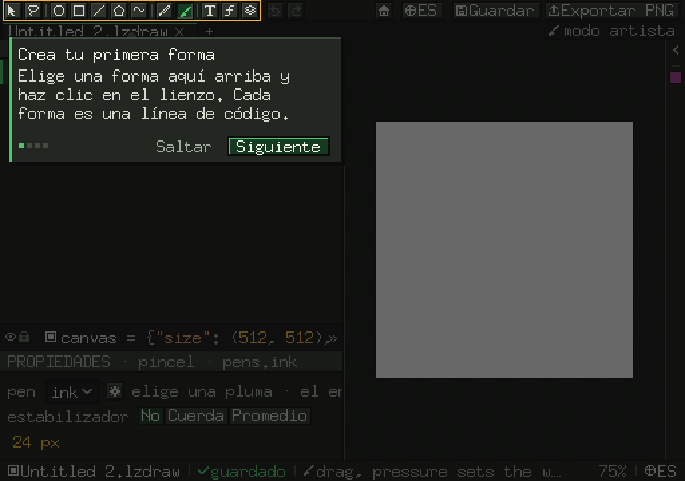 |

The coach-mark text, `Saltar` and `Siguiente` ✅.

1. **Status hint in English**: `drag, pressure sets the w…`. Expected: `arrastra, la presión da el grosor` (that string exists; it only appears after the tool is picked again).
   ✓ The hint is worked out when painted, so it follows the language ([shot](../Art/Checks/v1.1/extra-status-hint-stale-es-fixed.png)).
2. **Properties hint clipped mid-word**: `elige una pluma · el er`. Expected: the hint wraps to the hint line, or ends with `…` at a word boundary.
   ✓ Hints end at a word with `…` (`arrastra, la…`; the inspector row shows the tool hint, the gear has its tooltip).
3. The brush tool stays active after the tutorial, so a new drawing opens with the brush properties instead of `nada seleccionado`.
   ✓ Finishing the tutorial drops the brush ([shot](../Art/Checks/v1.1/R002-14-tutorial-done-fixed.png)); ES step 1: [shot](../Art/Checks/v1.1/R002-14-tutorial-1-es-fixed.png).

## R002-15 New drawing dialog – object budget · 🟡

| Approved (`21:3826`) | App |
|---|---|
| 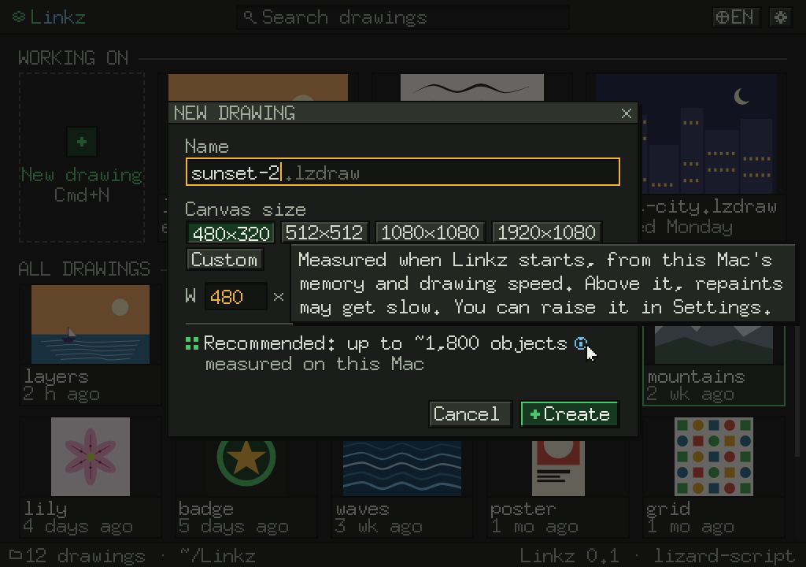 | 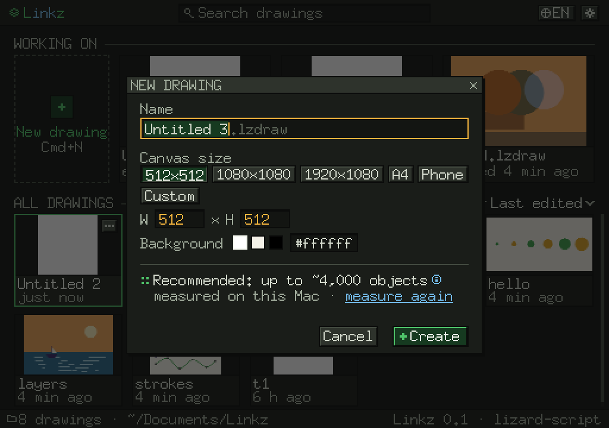 |

Tooltip on ⓘ: 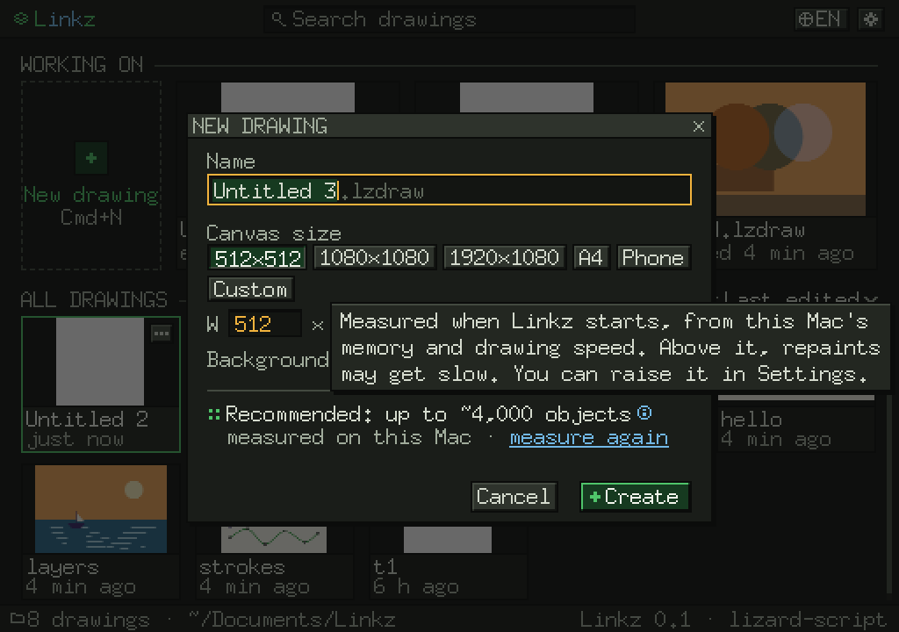

Dialog over the 62% dim, header, name field with `.lzdraw` in `dim`, presets as buttons, W × H, rule, budget line with ⓘ, tooltip text, Cancel / Create ✅.

1. **Presets differ.** The app has 512×512, 1080×1080, 1920×1080, A4 and Phone; the frame starts with **480×320** (selected), then 512×512, 1080×1080, 1920×1080. Add 480×320 back as the first preset and the default, since the examples and tutorial assume it.
   ✓ 480×320 is the first preset and the default, then 512×512, 1080×1080, 1920×1080, A4, Phone ([shot](../Art/Checks/v1.1/R002-15-new-drawing-fixed.png)).
2. **Additions: `Background` row (3 swatches + hex) and `measure again` link.** Good features; the dialog is 20 UI px taller than spec (214). Fine, but update the frame or the metric.
3. The objects icon is smaller than the frame's 2×2 dot block. Check `icon/objects`.
   ✓ `objects` is the frame's four 3×3 dots (dialog and status bar).

## R002-16 New drawing dialog – Spanish · 🟡

| Approved (`21:3890`) | App |
|---|---|
| 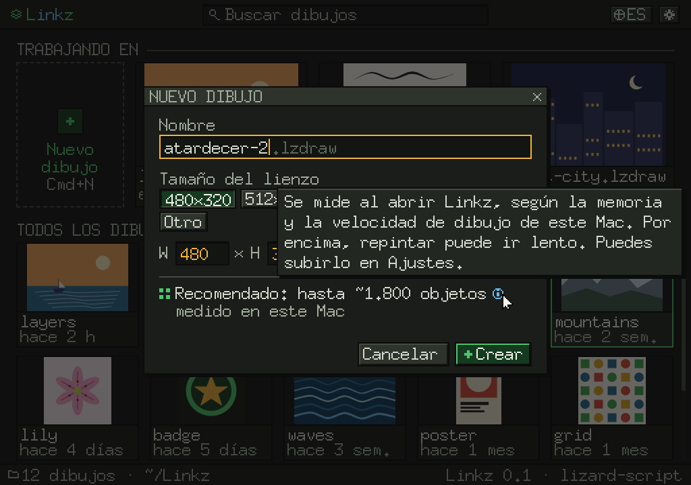 | 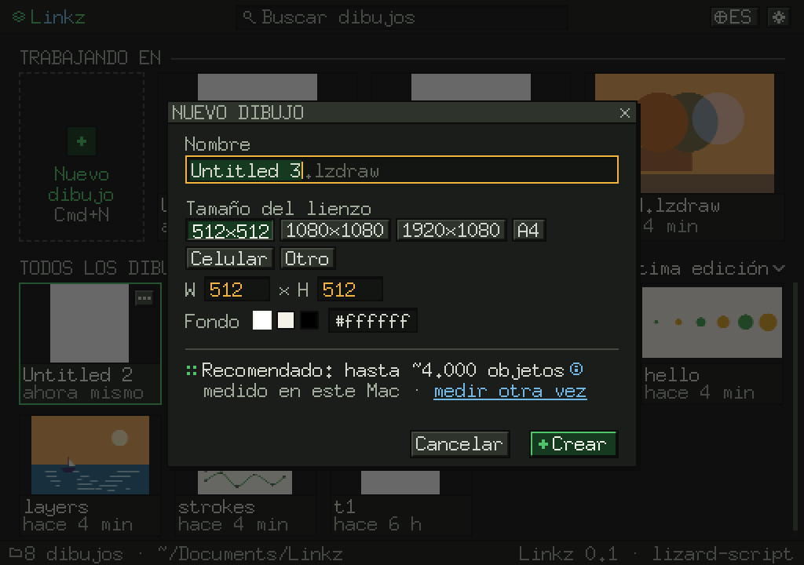 |

1. **Default name not localized**: `Untitled 3`. Expected a Spanish name (`Sin título 3`). The frame suggests a name from the current drawing (`atardecer-2`).
   ✓ `Sin título N`, and an untouched name follows a language change while the dialog is open ([shot](../Art/Checks/v1.1/R002-16-new-drawing-es-fixed.png)). A name from the current drawing (`atardecer-2`) is not done: the dialog opens from Home, with no drawing.
2. Presets wrap to a second row (`Celular`, `Otro`); the frame wraps only `Otro`. Fine.

## R002-17 Status bar – object counter (normal, near, over) · 🟡

| Approved (`21:3556`) | App (normal / near / over + tooltip) |
|---|---|
| 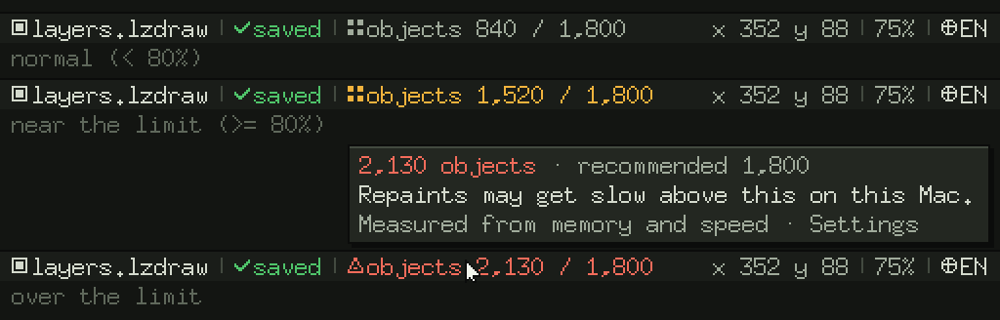 | 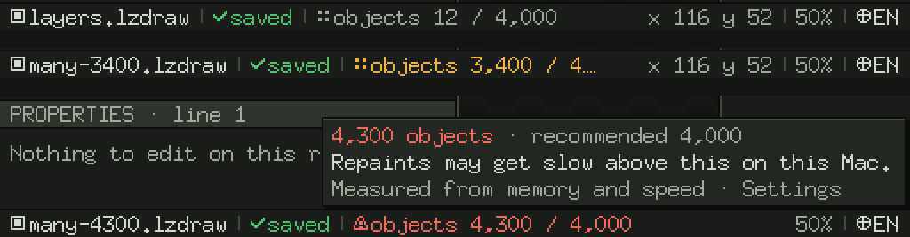 |

Normal (`mute`), over (`ember` + warn icon + 3-line tooltip, same text) ✅.

1. **Near state truncated**: `objects 3,400 / 4…` when the cursor position is shown, with ~100 px of empty bar left. Expected: the counter never truncates; the cursor position gives way first. Also seen at 1 object: `objects 1 / 4,0…` ([extra shot](../Art/Checks/v1.1/extra-status-counter-truncated.png)).
   ✓ The counter never shortens; the cursor position gives way first, and the two sides keep 18 px apart instead of 26 ([shot](../Art/Checks/v1.1/R002-17-object-counter-fixed.png)).
2. **Tool hint replaces the counter** while brush/pencil is active (R002-13). After switching to EN the hint can stay Spanish ([extra shot](../Art/Checks/v1.1/extra-status-hint-stale-es.png)).
   ✓ As top issue 5.

## R002-18 / R002-19 Pen settings – old panel · superseded

Kept on ✅ Approved for history. Both frames are replaced by the 18b / 19b pop-up, which is what the app builds. Not checked.

## R002-18b Pen settings pop-up – coder · 🟡

| Approved (`21:4003`) | App |
|---|---|
| 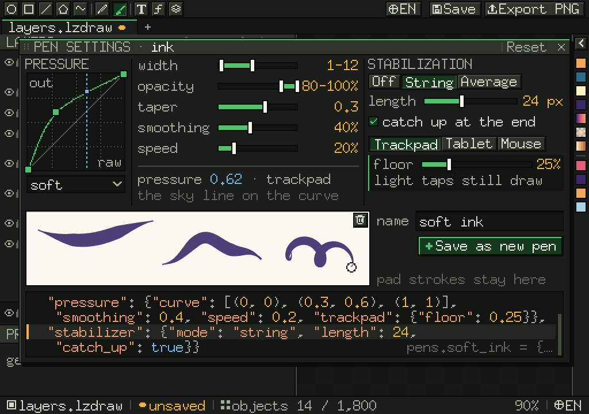 | 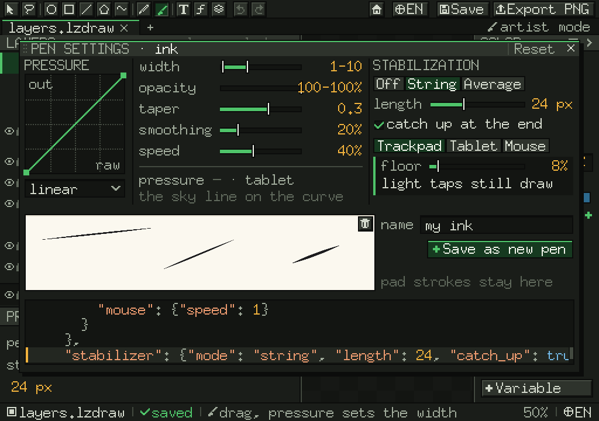 |

The window (title bar with `lizard` top line, grip, Reset, ✕, 3 px hard shadow), the three columns, `String` selected, test pad with trash, name + Save as new pen, `pad strokes stay here`, and the code block scrolled to the changed line (`row` + 2 px `amber` bar) ✅.

1. **Changed code line clipped**: `"stabilizer": {…, "catch_up": tru` at the edge. Expected: the code block wraps long lines (frame: `"catch_up": true}}` on the next line).
   ✓ Long lines wrap after a `, ` (the rest indented two more), and every piece of the changed line is marked ([shot](../Art/Checks/v1.1/R002-18b-pen-settings-popup-coder-fixed.png)).
2. **No 3 px scrollbar** on the code block (spec: scrolls 4 of 6 lines with a 3 px scrollbar).
   ✓ The 3 px scrollbar shows whenever the (wrapped) lines are more than 4; the pen hash is 4–6 lines, so it shows now.
3. Pad strokes come out very thin for pressure 0.2–1.0 with width 1–10. Partly drive input (2-point straight strokes). Worth one real check with a tablet that pressure → width shows on the pad.
4. The live readout during a stroke (`pressure 0.62` in `sky` + the dashed line on the curve) is not verifiable (mid-gesture).

## R002-18b-2 Pen settings pop-up – empty test pad · ✅

| Approved (`21:4091`) | App |
|---|---|
| 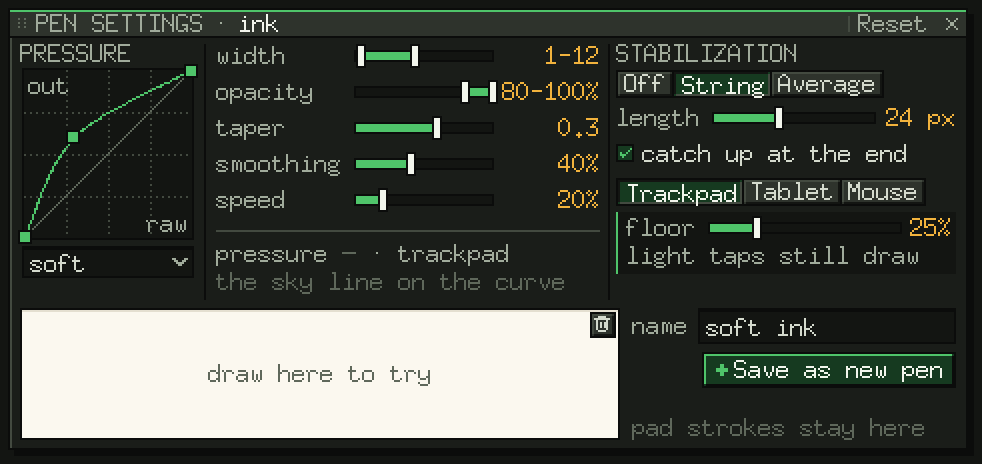 | 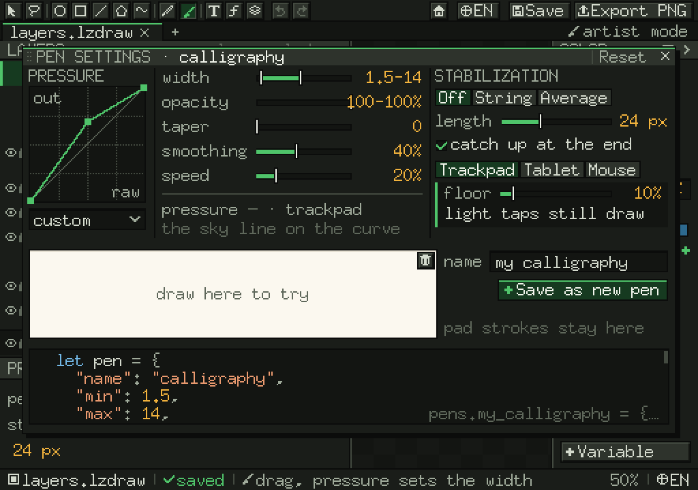 |

Same layout. `draw here to try` is centred in `dim` on paper, and the readout `pressure — · trackpad` shows. Shown here for calligraphy; the frame shows ink.

## R002-18c Pen picker – ⚙ per row · ✅

| Approved (`21:3954`) | App |
|---|---|
| 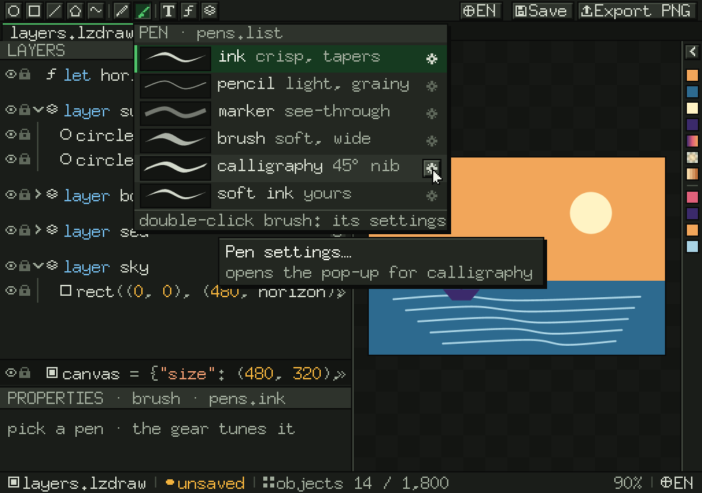 | 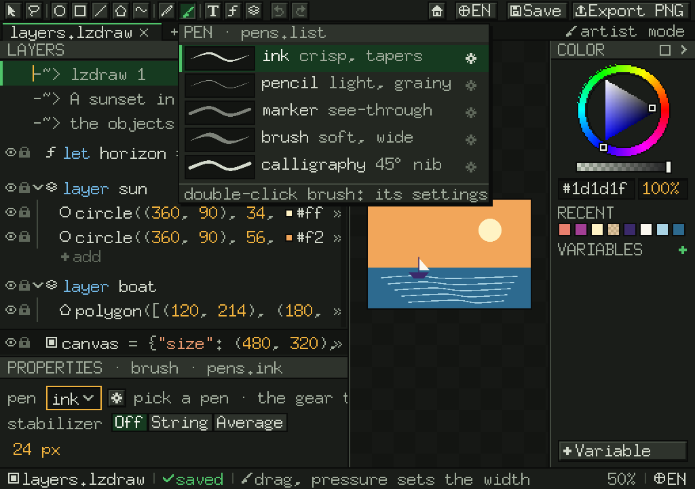 |

Header `PEN · pens.list`, preview strokes, the ⚙ on every row (`text` on the current pen, `dim` elsewhere), the footer `double-click brush: its settings`. It sits under the brush button, now further right because select and lasso come first ✅. The `soft ink` row is absent because the isolated HOME has no saved pen. The gear's hover button + tooltip `Pen settings…` wasn't captured (moving there clicked it and opened the pop-up, which is correct).

## R002-19b Pen settings pop-up – artist, Spanish · 🟡

| Approved (`21:4038`) | App |
|---|---|
| 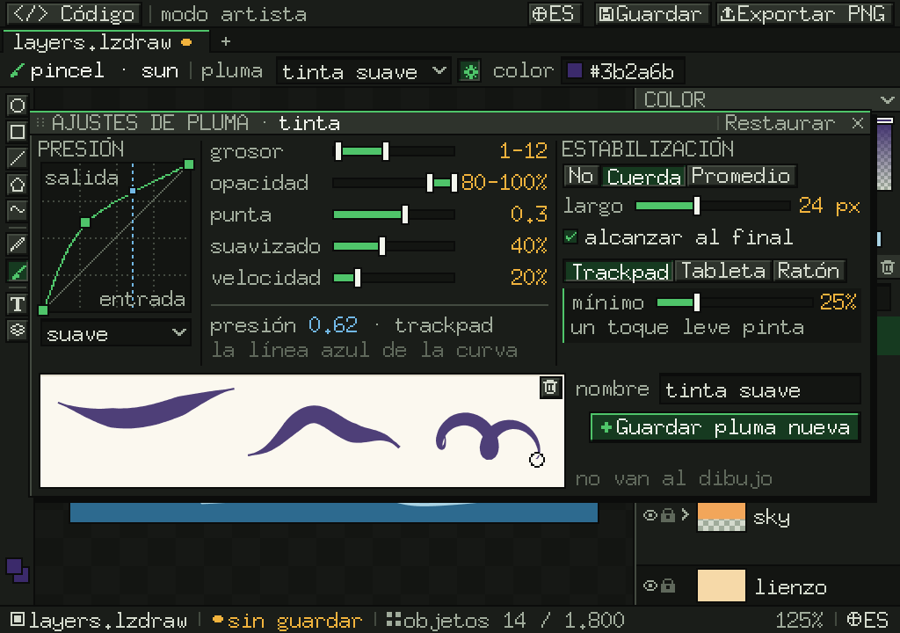 | 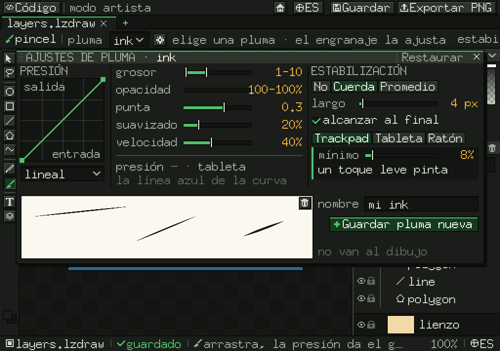 |

Opened from the ⚙ in the brush inspector. All labels are translated (AJUSTES DE PLUMA, Restaurar, salida/entrada, grosor … velocidad, ESTABILIZACIÓN No/Cuerda/Promedio, largo, alcanzar al final, Trackpad/Tableta/Ratón, mínimo, nombre, Guardar pluma nueva, no van al dibujo) ✅.

1. **Built-in pen names not localized**: title `· ink`, name field `mi ink`. Expected `· tinta`, `tinta …`. Also in the ES picker ([extra shot](../Art/Checks/v1.1/extra-pen-picker-es.png)): `ink`, `pencil`, `calligraphy`, with no description for pencil and calligraphy.
   ✓ `AJUSTES DE PLUMA · tinta`, `mi tinta`, and the picker's `tinta`, `lápiz`, `caligrafía` with their descriptions ([shot](../Art/Checks/v1.1/R002-19b-pen-settings-popup-artist-es-fixed.png), [picker](../Art/Checks/v1.1/extra-pen-picker-es-fixed.png)).
2. **Artist brush inspector overflows**: `elige una pluma · el engranaje la ajusta  estabi` runs off the right edge, hiding the stabilizer control. Expected (R003-4 frame): `pincel · capa | pluma [▾] ⚙ | estabilizador No/Cuerda/Promedio 24 px`, with the hint dropped in the context bar.
   ✓ `pincel | pluma [tinta ▾] ⚙ | estabilizador No Cuerda Promedio 24 px`, no hint in the bar (same shot).

## R002-20 Autocomplete – typing `ci` · 🔴

| Approved (`21:3647`) | App |
|---|---|
| 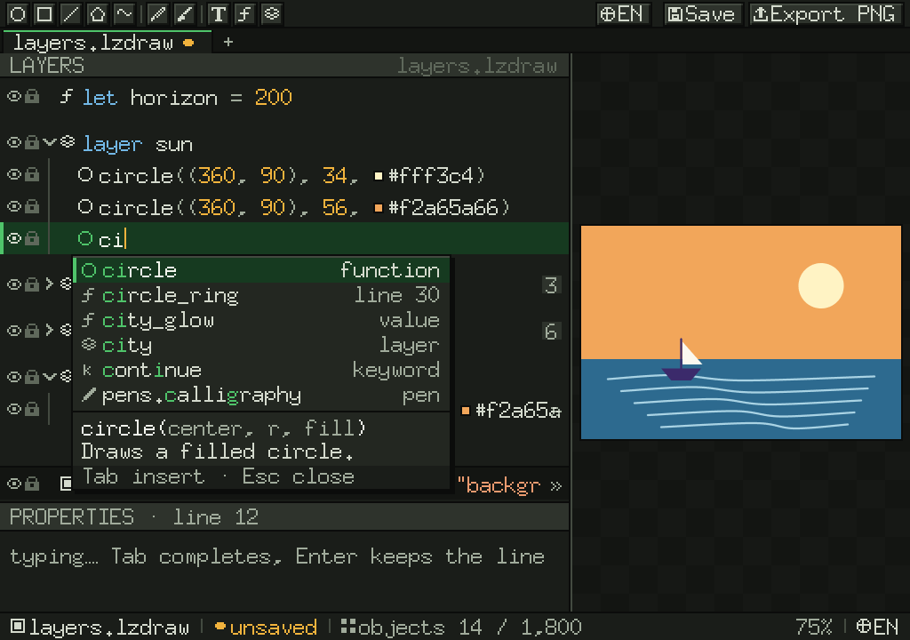 | 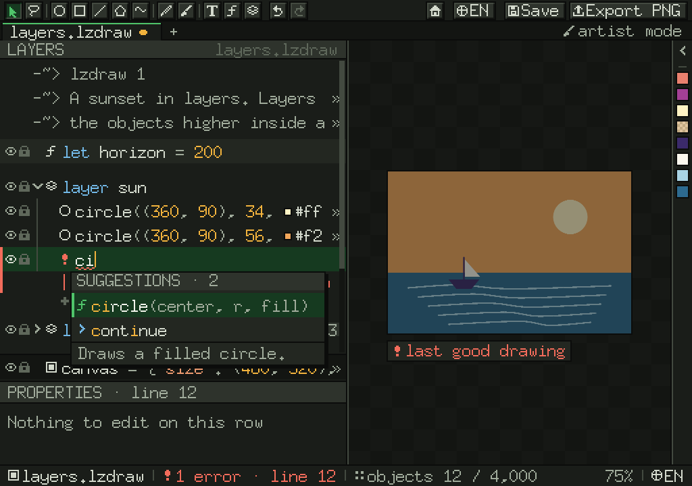 |

Fixed (B053 lane B): 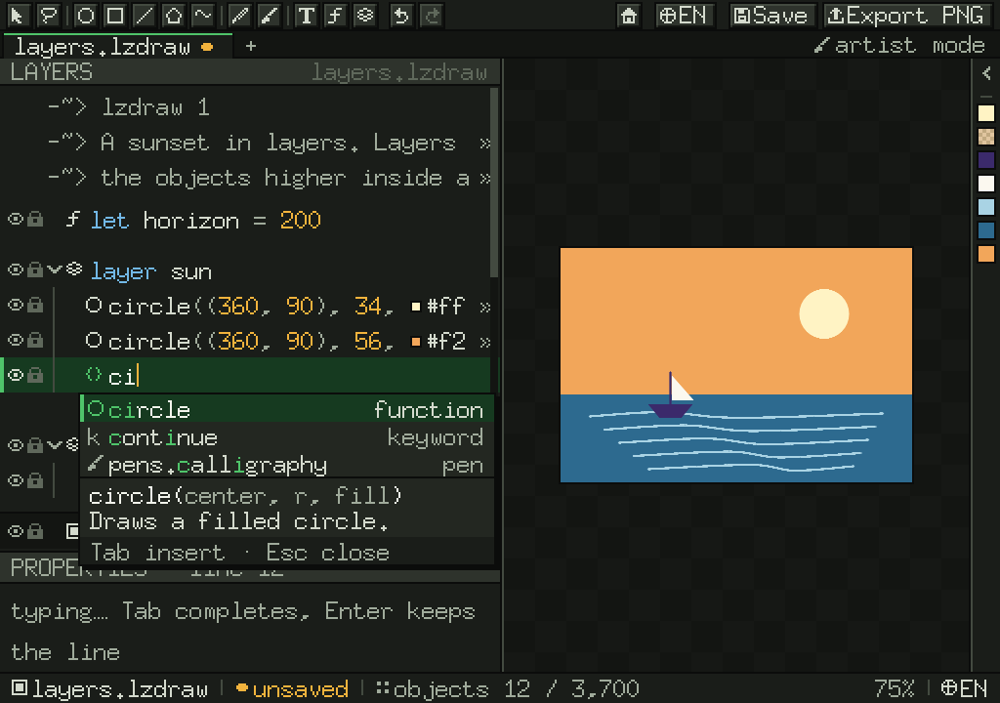 · Spanish: [shot](../Art/Checks/v1.1/R002-20-autocomplete-es-fixed.png)

1. **Error state while typing.** Typing `ci` immediately shows the red error row, dims the canvas with `last good drawing`, and reads `1 error · line 12` in the status bar. Expected (frame): no error while the line is being typed and the popup is open; properties hint `typing… Tab completes, Enter keeps the line`. Run the drawing without the unfinished line, or hold the error until Enter or the caret leaves the line.
   ✓ When the only change since the last good run is typing on the caret's row, its errors are held: the last good drawing stays (no dimming, no error row, no status error) and the properties panel says `typing… Tab completes, Enter keeps the line` (on two lines where the 256-wide panel is too narrow). Enter, a click or an arrow off the row shows them.
2. **Kind column missing.** Rows show the signature inline (`circle(center, r, fill)`). Expected: label left, kind right in `mute` (`function`, `line 30`, `value`, `layer`, `keyword`, `pen`).
   ✓ Kind column added, in both languages; a document's own function shows `line N` of its definition. `pens.*` are now offered with the names (kind `pen`), as in the frame.
3. **Footer missing**: `Tab insert · Esc close`.
   ✓ Footer band added (`Tab inserta · Esc cierra` in Spanish).
4. **Doc block** is one line (`Draws a filled circle.`). Expected: signature line + doc line.
   ✓ Signature (name and parentheses `bright`, parameters `mute`) + doc line.
5. **Matched letters `amber`**; spec `lizard`.
   ✓ `lizard`.
6. **Icons**: `circle` gets ƒ; spec is the kind's icon (○ for a shape call, layer icon for layers, `k` for keywords, pen icon for pens).
   ✓ A shape function gets its row icon, other functions and values ƒ, layers the layer icon, keywords `k`, pens the brush; `lizard` on the selected row, `mute` on the others. Left as is: the code row being typed keeps its own row icon (the frame previews ○ there).
7. Extra header `SUGGESTIONS · 2` (not in the frame); width ~187, spec 214.
   ✓ No header; 214 wide (grows to 330 for long names), the names lined up with the word typed.
8. The popup didn't open on its own after `Type ci` (needed `Call Complete`). Check that typing opens it.
   ✓ Checked: `Type ci` (one command, or one letter at a time) opens it after `Key Enter` on a new row. Kept from B007c: the ranking (prefix, then recently used, then shorter, then alphabetical), so the frame's order (circle_ring before city) and `sqrt` before `seed` differ.

## R002-21 Autocomplete – signature hint · 🟡

| Approved (`21:3673`) | App |
|---|---|
| 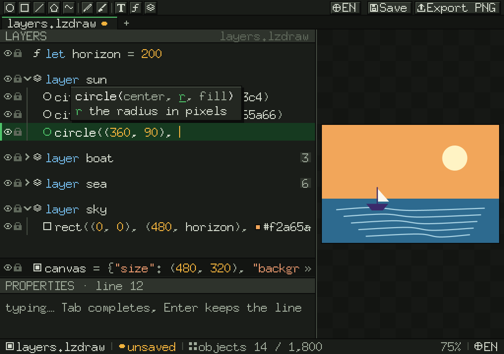 | 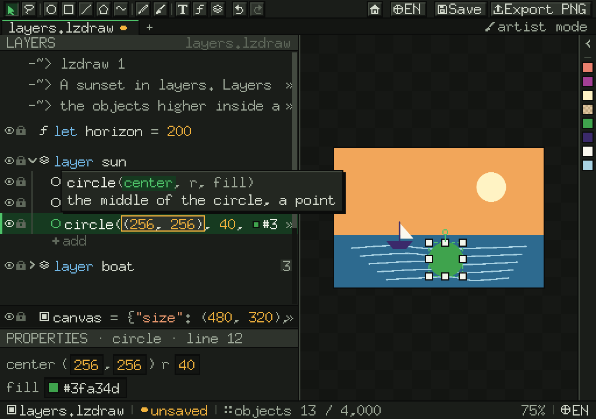 |

Fixed (B053 lane B): 

Tab inserts a snippet `circle((256, 256), 40, #3fa34d)` with the first argument selected, and the hint shows above the row ✅.

1. **Current parameter style**: `moss` background. Spec: `lizard` text + 1 px underline.
   ✓ `lizard` + 1 px underline; name and parentheses `bright`.
2. **Doc line lacks the parameter name**: `the middle of the circle, a point`. Expected `center the middle of the circle, a point`, with `center` in `lizard`.
   ✓ `r the radius in pixels`, the name in `lizard`. Not in lane B: while a call is half typed, the rows below it read as its continuation (no eye/lock, no indent) until it is closed; the frame keeps them.

## R002-22 Autocomplete – member `math.s` · 🔴

| Approved (`21:3699`) | App |
|---|---|
| 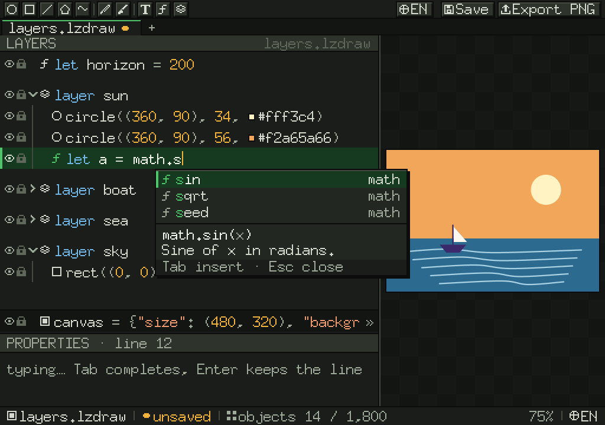 | 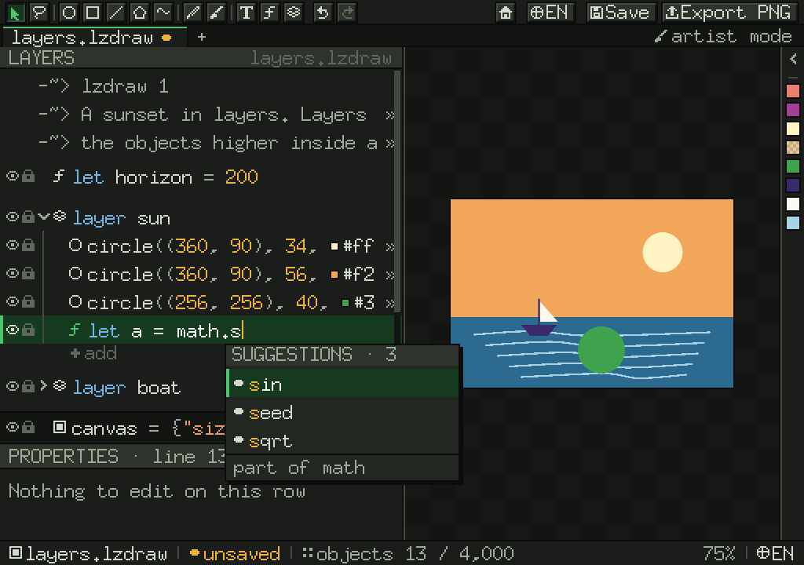 |

Fixed (B053 lane B): 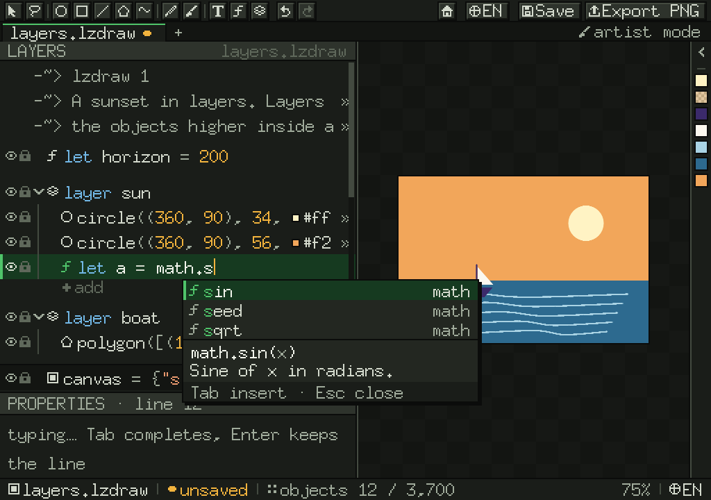

1. **Doc block says `part of math`.** Expected the signature `math.sin(x)` + `Sine of x in radians.`
   ✓ Every `math.`, `text.` and `list.` member has its signature and a doc line in English and Spanish (`member.*` keys); pens show their description, a document's hash keys `part of colors`.
2. **No kind column** (`math` right-aligned), **dot icons** instead of ƒ, **no footer**, extra header, matched `s` `amber` (as R002-20).
   ✓ As R002-20: `math` in the kind column, ƒ, footer, no header, `lizard` letters.
3. The properties hint is `Nothing to edit on this row`; expected `typing… Tab completes, Enter keeps the line`.
   ✓ Shown while the list is open on the row or its errors are held.

## R002-23 Color popover – from a code-row swatch · 🟡

| Approved (`21:3725`) | App |
|---|---|
|  |  |

The app shows the ring + triangle and the HARMONY block instead of the frame's square picker. That is correct: the approval decided the wheel replaces the square in the popover (R003-5).

1. **Signature hint shows at the same time**: `circle(center, r, fill) / the color inside` floats over the rows. Expected: opening the popover closes the hint.
   ✓ The hint waits while the popover is open, and after it closes until the caret moves ([shot](../Art/Checks/v1.1/R002-23-color-popover-row-fixed.png)).
2. **Placement**: the popover opens right of the swatch, from y 52, and covers the literal it edits plus the rows. Expected (frame): under the row, tail up to the swatch, so the row stays readable.
   ✓ It opens under the row (tail up) when it fits, as for `colors` in [R003-5](../Art/Checks/v1.1/R003-05-color-wheel-harmonies-fixed.png). With the wheel it is 274–288 high, so in a 360-high window it fits under a row only near the top of the code; elsewhere it goes right of the literal (over the canvas), and the row stays readable. Kept on purpose: shrinking the wheel or the harmony block would break the R003-5 metrics ([shot](../Art/Checks/v1.1/R002-23-color-popover-row-fixed.png)).
3. The clicked swatch gets no `amber` ring (frame: 1 px `amber` around it while its popover is open).
   ✓ 1 px `amber` ring around the swatch while its popover is open.

## R002-24 Color popover – fill field, save as variable · 🟡

| Approved (`21:3753`) | App (before / after "Save as variable…") |
|---|---|
|  |   |

Tail down to the fill field, inline name field + `Save`, and `writes colors.glow2` ✅.

1. **The popover jumps ~170 px right** when the name field opens, and loses its anchor and tail to the fill field. Expected: it grows in place (upward), still pointing at the field.
   ✓ The name field and Save take the place of the `+ Save as variable…` row (as in the frame), so the popover keeps its size and place ([before](../Art/Checks/v1.1/R002-24-color-popover-field-before-save-fixed.png), [after](../Art/Checks/v1.1/R002-24-color-popover-field-fixed.png)).
2. The fill field has no `amber` ring while its popover is open.
   ✓ The field gets the 1 px `amber` ring while its popover is open.
3. `as colors.color_2, co…` is clipped, and `color_2` is a generic name. For a literal, suggest names from the closest variable (`sun_2`) or the hue (`yellow_2`), and wrap rather than clip.

## R002-25 Color popover – artist mode, Spanish · 🔴

| Approved (`21:3780`) | App: fill = `colors.sun` (the frame's case) | App: literal fill |
|---|---|---|
|  |  |  |

1. **With `colors.sun`, no popover opens.** The `relleno` field is a text field (no swatch). Clicking it starts a text edit with the caret. Expected: swatch + `colors.sun`, and a click opens the popover with `sun` as the current variable (top issue 1).
   ✓ `relleno [■ colors.sun]`; its swatch opens the popover under the field with `sun` current ([shot](../Art/Checks/v1.1/R002-25-named-color-field-es-fixed.png)). Like a literal, a click on the text still edits it.
2. With a literal fill the popover opens and is fully translated (VARIABLES, RECIENTES, ARMONÍA triádica, era/ahora, `+ añadir`, Guardar variable…, escribe) ✅. But it opens **up-left over the context bar and the tab bar** (top at y 19) and covers the field it edits. Expected: below the field, tail up.
   ✓ It now opens under the field, tail up, and fits above the status bar ([shot](../Art/Checks/v1.1/R002-25-color-popover-artist-es-fixed.png)).
3. `anillo: tono` wraps onto 3 lines; `como colors.color_2, …` is clipped.
4. The compact palette shows the pen color `#1d1d1f`, not the selection's fill (frame `COLOR #fff3c4`). The compact palette's collapsed state also carried over from the coder rail.
   ✓ Lane C: the compact palette shows the selected shape's fill (as R002-6).

## R003-1 Select tool – moving 2 objects · 🟡

| Approved (`21:4095`) | App (after the move) |
|---|---|
|  |  |

Click + Shift-click gives 2 objects; rows 10–11 get `moss` + bar; the box is dashed `lizard` with 8 handles + rotation stalk; the rows update live (`331, 130`); properties read `select · lines 10, 11`, `2 objects · move ( dx , dy )` + hint ✅.

1. **Stale signature hint** (`circle(center, r, fill) / the color inside`) stays over the code rows while using the select tool on the canvas. It should close when the caret's row loses focus or a canvas tool acts.
   ✓ A canvas tool's press and release quiet the hint until the caret moves again ([shot](../Art/Checks/v1.1/R003-01-select-move-fixed.png)).
2. Not verifiable: the dotted `mute` ghost and the `move -30, +40` tooltip during the drag.

## R003-2 Lasso select – loop in progress · ✅ (verifiable part)

| Approved (`21:4123`) | App (lasso tool, no loop) |
|---|---|
|  |  |

The options strip matches the frame exactly: `lasso select`, Select / Fill segmented with icons, ☑ catch up, Off / String / Average, length slider and `24 px`. Not verifiable: the marching ants, the closing line, the string and the pre-selected objects inside the loop.

## R003-3 Lasso fill – loop became a polygon row · not verifiable

| Approved (`21:4149`) | App (fill mode, a straight drag) |
|---|---|
|  |  |

The header `lasso fill · ■ #1d1d1f` with the current color swatch ✅. A straight drag correctly refuses with `the loop is too small to fill` in `ember`. Making a real polygon row (with the `new` badge) needs a loop, which `drive` can't draw. Re-check with the `Path` command proposed above.

## R003-4 Brush – pulled-string stabilizer · 🟡

| Approved (`21:4176`) | App (after a stroke) |
|---|---|
|  |  |

The stroke lands in the current layer as `brush([…], [pressures], #1d1d1f, pens.ink)` and is selected in LAYERS ✅.

1. **Artist context bar overflows with the brush.** With a selection, the bar shows the selected shape's fields and then the brush's, and `stabilizer O…` is cut at the right edge ([extra shot](../Art/Checks/v1.1/extra-artist-context-bar-overflow.png): the circle's fields + `stabilizer` off the edge). Expected (frame): with the brush active, the bar is the brush inspector `brush · layer | pen [▾] ⚙ | stabilizer Off/String/Average 24 px`. The selection's fields come back when you switch to Select.
   ✓ With the brush the bar is the brush inspector `brush · sky | pen [ink ▾] ⚙ | stabilizer Off String Average 24 px`, the canvas shows nothing selected, and the selection's fields come back with Select ([shot](../Art/Checks/v1.1/R003-04-brush-stabilizer-fixed.png)).
2. Not verifiable: the `sky` string, the radius circle, the ink only at the pen tip, the tooltip `ink follows the string`, and `pressure 0.71` in the status bar.

## R003-5 Color popover – wheel + harmonies · 🟡

| Approved (`21:4223`) | App |
|---|---|
|  |  |

Very close: the ring 88 Ø + triangle, the hue / harmony / triangle markers, the 6 harmony segments with `triadic` selected, the 3 swatches, `+ add all`, `as colors.sky_2, sky_3`, `writes colors.sky`, and `sky` current in `moss`, with the tail ✅.

1. **Placement**: right of the swatch, from y 55, covering the row text. Expected: below the row (frame), so `"sky": ■ #f2a65a` stays readable.
   ✓ Under the row, tail up to the swatch, `"sky": ■ #f2a65a` readable ([shot](../Art/Checks/v1.1/R003-05-color-wheel-harmonies-fixed.png)).
2. The properties panel says `Nothing to edit on this row` for `let colors`. Expected: `let colors` + the hint `click a swatch: color popover`.

## R003-6 Trace image dialog · not built

| Approved (`21:4251`) |
|---|
|  |

Waits on the tracing engine (Tracing v2). Nothing to compare.

---

## Notes for the design

- **`hard()` and the frame disagree.** R002-9's code preview shows `hard(#f2a65a, 0.6)`, but the library's `hard(color)` takes one argument. The position comes from the stop's place, or from `[[0.6, hard(c)]]`. The one-argument call is the better API (one way to place a stop), so the frame's preview should read `hard(#f2a65a)`. Logged here, not changed in Figma.
- **Additions the app made that I'd keep** (worth drawing into the frames next pass): Arrange items and Blend ▸ in the shape menu, the `angle` and `alcance` rows in the fill editor, Background + `measure again` in the New drawing dialog, `Back` in the tutorial, `name / hidden / locked` in layer properties.
